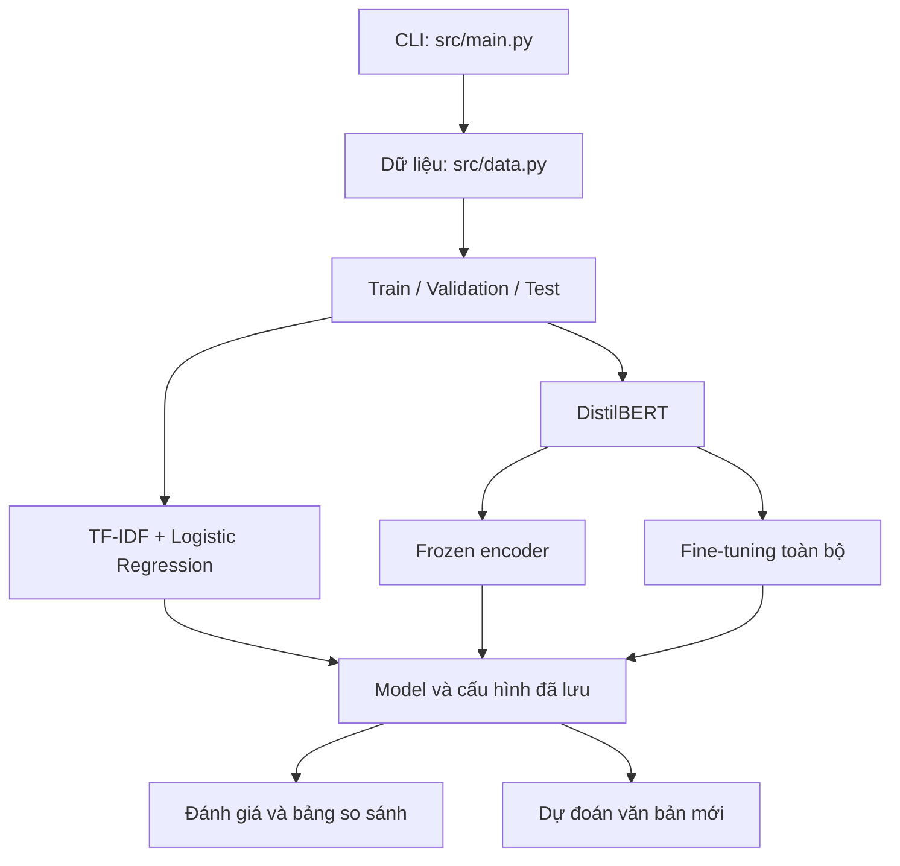

<<<<<<< HEAD
# AG News – News Topic Classification

Dự án phân loại chủ đề tin tức tiếng Anh bằng Python, sử dụng bộ dữ liệu AG News. Nhóm gồm 5 thành viên, so sánh DistilBERT theo hai phương pháp: **fine-tuning toàn bộ mô hình** và **đóng băng encoder (frozen encoder)**. TF-IDF kết hợp Logistic Regression được dùng làm baseline.

Tài liệu này trình bày **Define & Design**, hướng dẫn chạy và tình trạng kiểm chứng. Đây là bản thiết kế cập nhật của bộ mã khởi tạo, không phải bằng chứng rằng mọi chức năng đã hoàn thành hoặc thiết kế này đã được lập trước khi viết mã.

## 1. DEFINE – Xác định bài toán

### 1.1. Project name – Tên dự án

**AG News – News Topic Classification** — Hệ thống phân loại chủ đề tin tức với DistilBERT.

### 1.2. Problem – Bài toán

Việc đọc và gán chủ đề thủ công cho nhiều bài báo tốn thời gian. Dự án xây dựng một pipeline tự động nhận văn bản tin tức tiếng Anh và gán vào một trong bốn chủ đề: World, Sports, Business và Sci/Tech.

Bài toán học máy là **phân loại văn bản đa lớp, mỗi bài có một nhãn**. Ngoài khả năng phân loại, dự án nghiên cứu mức chênh lệch chất lượng và chi phí huấn luyện giữa fine-tuning toàn bộ DistilBERT và chỉ huấn luyện classification head khi encoder bị đóng băng.

Phạm vi phiên bản đầu: xử lý dữ liệu CSV, chạy thực nghiệm và dự đoán qua dòng lệnh. Không bao gồm thu thập tin tức trực tuyến, giao diện web, tài khoản người dùng hoặc phân loại tin tức tiếng Việt. Baseline là mô hình đối chiếu bổ sung; DistilBERT là mô hình chính.

### 1.3. Target users – Người dùng mục tiêu

| Nhóm người dùng dự kiến | Nhu cầu | Cách sử dụng |
|---|---|---|
| Sinh viên và người nghiên cứu NLP | Tái hiện thực nghiệm và so sánh phương pháp | Chuẩn bị dữ liệu, train, evaluate, compare |
| Người thử nghiệm công cụ hỗ trợ phân loại nội dung | Gợi ý chủ đề cho một bản tin tiếng Anh | Nhập văn bản qua lệnh predict |
| Thành viên nhóm và giảng viên | Kiểm tra quy trình, kết quả và đóng góp | Đọc cấu hình, báo cáo, mã nguồn và bảng phân công |

Đây là nhóm người dùng định hướng; chưa có khảo sát hoặc triển khai thực tế cho đơn vị báo chí.

### 1.4. Input / Output – Đầu vào và đầu ra

**Đầu vào huấn luyện:** hai file `data/raw/train.csv` và `data/raw/test.csv` từ bộ dữ liệu đính kèm, có các cột:

| Cột | Nội dung | Quy tắc |
|---|---|---|
| Class Index | Nhãn gốc | Một trong các giá trị 1, 2, 3, 4 |
| Title | Tiêu đề | Ghép với Description thành văn bản |
| Description | Mô tả tin tức | Ô thiếu được thay bằng chuỗi rỗng |

**Đầu vào dự đoán:** một chuỗi văn bản tin tức tiếng Anh không rỗng truyền qua `--text`.

**Đầu ra dự đoán:** một tên chủ đề; phiên bản hiện tại không xuất điểm độ tin cậy.

| Nhãn gốc | Nhãn nội bộ | Tên chủ đề | Ý nghĩa |
|---|---|---|---|
| 1 | 0 | World | Tin thế giới |
| 2 | 1 | Sports | Thể thao |
| 3 | 2 | Business | Kinh doanh |
| 4 | 3 | Sci/Tech | Khoa học và công nghệ |

**Đầu ra thực nghiệm:** dữ liệu đã xử lý, mô hình đã lưu, cấu hình chạy, metrics JSON, confusion matrix PNG, dự đoán CSV và bảng so sánh CSV. Các đường dẫn cụ thể nằm ở mục 2.5.

### 1.5. Core features – Chức năng cốt lõi

| Mã | Chức năng | Kết quả mong đợi |
|---|---|---|
| F01 | Kiểm tra và chuẩn hóa dữ liệu | Đọc đúng cột, kiểm tra nhãn và văn bản rỗng, ghép tiêu đề với mô tả |
| F02 | Chuẩn bị tập train/validation/test | Chia tập cố định, không giao nhau về văn bản sau xử lý |
| F03 | Huấn luyện baseline | TF-IDF + Logistic Regression, chỉ fit trên train |
| F04 | Huấn luyện frozen encoder | Đóng băng encoder DistilBERT, cập nhật classification head |
| F05 | Fine-tuning toàn bộ | Cập nhật toàn bộ mô hình DistilBERT, lưu checkpoint tốt nhất theo validation macro-F1 |
| F06 | Đánh giá và so sánh | Accuracy, macro-F1, chỉ số từng lớp và confusion matrix |
| F07 | Dự đoán bài báo mới | Tải lại mô hình đã lưu và trả một trong bốn chủ đề |
| F08 | Lưu thông tin thực nghiệm | Lưu cấu hình, số mẫu; Transformer có lịch sử loss/F1 và thời gian chạy |

EDA, vẽ đường học và phân tích mẫu sai là đầu việc nhóm cần hoàn thiện theo bảng phân công; bộ mã hiện tại chưa tự động hóa toàn bộ các phần này.

### 1.6. Technology constraints – Ràng buộc công nghệ

| Nội dung | Quyết định / ràng buộc |
|---|---|
| Ngôn ngữ | Python; môi trường dự án dự kiến Python 3.11 hoặc 3.12 |
| Công cụ | VS Code, Git và GitHub để phát triển nhóm |
| Thư viện | pandas, NumPy, scikit-learn, matplotlib, PyTorch, Hugging Face Transformers |
| Mô hình chính | `distilbert/distilbert-base-uncased`; giữ cùng checkpoint gốc khi so sánh hai chế độ |
| Phần cứng | Baseline chạy CPU; Transformer dùng CUDA nếu môi trường hỗ trợ, nếu không dùng CPU với thời gian lâu hơn |
| Internet | Cần khi cài thư viện và tải tokenizer/trọng số lần đầu |
| Văn bản | Tiếng Anh; mô hình luôn gán một trong bốn lớp, chưa phát hiện chủ đề ngoài phạm vi |
| Độ dài | Mặc định tối đa 128 token cho Transformer; phần vượt giới hạn bị cắt |
| Lưu trữ | Dữ liệu và model lưu ở máy chạy; chưa sử dụng cơ sở dữ liệu hoặc server |
| Ngân sách thực nghiệm | Mặc định 3 epoch, batch size 16; nhóm điều chỉnh theo máy và ghi lại mọi thay đổi |

### 1.7. Evaluation criteria – Tiêu chí đánh giá và nghiệm thu

**Đánh giá mô hình:**

- Dùng **macro-F1** trên validation để chọn checkpoint và cấu hình; báo thêm Accuracy, Precision, Recall, F1 từng lớp và confusion matrix.
- Giữ cố định cách chia tập, seed 42, backbone, độ dài token và số mẫu train khi so sánh frozen với fine-tuning. Ghi rõ learning rate và các thay đổi khác.
- Chỉ đánh giá test sau khi chốt cấu hình. Không dùng kết quả test để tiếp tục chọn siêu tham số.
- So sánh chất lượng với số tham số được huấn luyện và thời gian chạy. Thời gian Transformer hiện được ghi gồm huấn luyện, validation và lưu checkpoint, chưa gồm tải trọng số.
- Chưa đặt ngưỡng Accuracy/F1 bắt buộc do chưa có yêu cầu điểm số từ giảng viên. Không coi số đo thử ít dữ liệu là kết quả thực nghiệm cuối cùng.

**Điều kiện nghiệm thu:**

| Hạng mục | Bằng chứng hoàn thành |
|---|---|
| Dữ liệu | Có train/validation/test; kiểm thử mapping nhãn và không giao text giữa các tập đều đạt |
| Huấn luyện | Baseline, frozen và fine-tuning tạo được model cùng cấu hình chạy |
| Đánh giá | Cả ba phương pháp có metrics và confusion matrix trên cùng tập test |
| Dự đoán | Tải lại model và chạy được bộ demo tối thiểu 8 tin, gồm 2 tin mỗi chủ đề; ghi lại nhãn dự đoán |
| So sánh | Có comparison.csv với cùng số mẫu train/test hoặc giải thích rõ khác biệt |
| Phân tích | Có phân tích ít nhất 20 mẫu sai, đồ thị học cho Transformer và nhận xét hạn chế |
| Tái hiện | Một thành viên khác chạy theo README trên môi trường mới và ghi nhận kết quả |
| Bàn giao | Có mã nguồn, phân công, báo cáo, slide và lịch sử đóng góp thực tế |

Bộ demo dùng để kiểm tra luồng dự đoán, không thay thế đánh giá chất lượng trên test.

## 2. DESIGN – Thiết kế hệ thống

### 2.1. System architecture – Kiến trúc hệ thống

Hệ thống chạy cục bộ theo kiến trúc pipeline. CLI tiếp nhận lệnh; module dữ liệu tạo các tập chuẩn; các module mô hình huấn luyện; module metrics đánh giá và xuất kết quả. Mô hình đã lưu được nạp lại cho luồng dự đoán.



Sơ đồ thể hiện quan hệ giữa các thành phần. Vai trò riêng của train, validation và test được quy định tại mục 2.4; không đưa test vào huấn luyện.

### 2.2. Modules – Các module

| Module | Trách nhiệm | Giao diện chính | Chủ trì |
|---|---|---|---|
| `src/data.py` | Đọc CSV, chuẩn hóa, mapping, chia tập | `load_raw`, `clean_text`, `prepare`, `read_split` | TV1 |
| `src/baseline.py` | Fit TF-IDF và Logistic Regression, lưu pipeline | `train(limit)` | TV2 |
| `src/transformer.py` | Tokenize, tạo DataLoader, train và suy luận hai chế độ | `NewsDataset`, `loader`, `train`, `infer` | TV3; TV2 phối hợp frozen |
| `src/metrics.py` | Tính chỉ số và xuất confusion matrix | `report(y, pred, folder, split)` | TV4 |
| `src/main.py` | Phân tích tham số CLI và điều phối | `main()` | TV5 |
| `tests/test_data.py` | Kiểm tra hợp đồng dữ liệu và giao nhau giữa các tập | unittest | TV1 và TV4 |

Tên TV1–TV5 là chỗ giữ chỗ để thay bằng tên thành viên thật. TV3 giữ module Transformer chung; TV2 gửi phần thay đổi frozen qua pull request để hạn chế xung đột.

### 2.3. Folder structure – Cấu trúc thư mục

Các đường dẫn dưới đây tính từ thư mục gốc repository, nơi đặt README và requirements.

```text
./                                      # Thư mục gốc AG-News-Classification
├── README.md                           # Define, Design và hướng dẫn chạy
├── requirements.txt                    # Thư viện cho toàn bộ pipeline
├── requirements-baseline.txt           # Thư viện riêng cho baseline CPU
├── .gitignore                          # Bỏ qua môi trường, dữ liệu và kết quả khi commit
│                                       
├── src/                                # Mã nguồn pipeline phân loại tin tức
│   ├── __init__.py                     # Khai báo Python package
│   ├── main.py                         # Entry point CLI; điều phối các lệnh
│   ├── data.py                         # Đọc CSV, làm sạch, mapping nhãn, chia tập
│   ├── baseline.py                     # TF-IDF + Logistic Regression
│   ├── transformer.py                  # DistilBERT: frozen encoder và fine-tuning
│   └── metrics.py                      # Metrics JSON và confusion matrix PNG
│                                       
├── data/                               # Dữ liệu cục bộ; không commit mặc định
│   ├── raw/                            # Chép hai CSV gốc từ ZIP dữ liệu vào đây
│   │   ├── train.csv                   # 120.000 mẫu huấn luyện gốc
│   │   └── test.csv                    # 7.600 mẫu kiểm tra gốc
│   └── processed/                      # Được tạo bởi lệnh prepare
│       ├── train.csv                   # Dữ liệu huấn luyện đã xử lý
│       ├── validation.csv              # Chọn cấu hình và checkpoint
│       └── test.csv                    # Đánh giá cuối sau khi chốt cấu hình
│                                       
├── outputs/                            # Được tạo khi chạy; không commit mặc định
│   ├── baseline/                       # Model baseline và kết quả đánh giá
│   │   ├── model.pkl                   # Pipeline TF-IDF + Logistic Regression đã lưu
│   │   └── run.json                    # Cấu hình baseline và số mẫu train
│   ├── frozen/                         # Checkpoint/tokenizer của frozen encoder
│   │   └── run.json                    # Cấu hình, lịch sử loss/F1 và thời gian
│   ├── finetune/                       # Checkpoint/tokenizer của fine-tuning
│   │   └── run.json                    # Cấu hình, lịch sử loss/F1 và thời gian
│   └── comparison.csv                  # Bảng so sánh test; tạo bởi lệnh compare
│                                       
├── tests/                              # Kiểm thử dữ liệu và pipeline
│   └── test_data.py                    # Mapping nhãn, nhãn sai và giao text giữa tập
│                                       
├── docs/                               # Tài liệu và phân công nhóm
│   ├── PHAN_CONG.md                    # 20 task cho 5 người, đầu ra và phụ thuộc
│   ├── tasks.csv                       # Bảng task mở bằng Excel / nhập công cụ quản lý
│   ├── VALIDATION.md                   # Ghi nhận kiểm chứng bộ mã khởi tạo
│   └── smoke_run/                      # Metrics/hình từ lần thử baseline 2.000 mẫu
│                                       
└── .venv/                              # Môi trường Python tự tạo; không commit
```

Cây trên thể hiện cấu trúc sau khi chuẩn bị dữ liệu và chạy pipeline, không có nghĩa mọi đầu ra đã có sẵn. Phần `outputs/` chỉ liệt kê một số file tiêu biểu. Sau khi đánh giá, mỗi thư mục model còn có `{split}_metrics.json`, `{split}_confusion_matrix.png` và `{split}_predictions.csv`; thư mục Transformer chứa thêm các file checkpoint/tokenizer do `save_pretrained` tạo.

Các thư mục đầu ra không cần tồn tại trước khi chạy. Nếu clone từ GitHub và thiếu CSV vì `.gitignore`, giải nén `train.csv` và `test.csv` từ bộ dữ liệu vào `data/raw/`.

### 2.4. Data flow – Luồng dữ liệu

**Chuẩn bị dữ liệu:**

1. Đọc train.csv và test.csv; kiểm tra cột bắt buộc và nhãn hợp lệ.
2. Thay phần Title/Description thiếu bằng chuỗi rỗng, ghép thành văn bản; giải mã HTML và chuẩn hóa khoảng trắng. Báo lỗi nếu văn bản cuối rỗng.
3. Chuyển nhãn 1–4 thành 0–3. Không bỏ stopword hoặc stemming trong bước chuẩn hóa chung; tokenizer và TF-IDF có xử lý riêng theo cấu hình của chúng.
4. Bỏ text trùng trong test và trong train theo nguyên tắc giữ lần đầu; bỏ các text của train xuất hiện trong test. Cần kiểm tra và báo cáo trường hợp cùng text có nhiều nhãn trong bước audit.
5. Chia dữ liệu train còn lại thành train/validation theo tỷ lệ 90/10, stratify theo nhãn và seed 42. Test không được trộn vào phép chia này.
6. Lưu CSV đã xử lý và kiểm tra không giao text giữa ba tập.

Dữ liệu gốc có 120.000 mẫu train và 7.600 mẫu test, cân bằng bốn lớp. Lần chạy prepare kiểm tra của bộ mã tạo ra 107.925 train, 11.992 validation và 7.600 test. Cần ghi lại số mẫu nếu thay đổi chính sách xử lý. Do có bước bỏ trùng, kết quả không được mặc định coi là tương đương protocol leaderboard dùng nguyên dữ liệu gốc.

**Huấn luyện và đánh giá:**

1. Baseline: fit TF-IDF chỉ trên train, biến đổi văn bản rồi huấn luyện Logistic Regression; đánh giá validation.
2. Transformer: tải tokenizer và checkpoint gốc, cắt tối đa 128 token mặc định, padding theo batch.
3. Frozen: đặt encoder `requires_grad=False` và `eval()`, chỉ tối ưu classification head. Fine-tuning: tối ưu toàn bộ tham số.
4. Tính validation macro-F1 sau mỗi epoch; lưu model tốt nhất cho mỗi chế độ.
5. Sau khi chốt cấu hình, tải checkpoint đã lưu, dự đoán test rồi xuất metrics, confusion matrix và các mẫu dự đoán.
6. Tổng hợp kết quả test vào comparison.csv; phân tích lỗi và chi phí thực nghiệm.

**Dự đoán:** CLI nhận `--text` và `--run`, chuẩn hóa văn bản, tải model tương ứng, biến đổi đầu vào rồi trả tên nhãn. Không cần chuẩn bị lại dữ liệu train cho một lần predict nếu model đã có.

### 2.5. Interfaces / APIs – Giao diện và hợp đồng dữ liệu

Phiên bản này dùng **CLI**, chưa có REST API hoặc HTTP endpoint. Các lệnh được gọi bằng `python -m src.main ...` từ thư mục gốc.

| Lệnh | Tham số chính | Đầu ra |
|---|---|---|
| `prepare` | Không có tham số bắt buộc | CSV trong data/processed; in số mẫu và phân bố nhãn |
| `baseline` | `--limit` mặc định 0 | outputs/baseline/model.pkl, run.json và validation metrics/hình |
| `train` | `--mode frozen` hoặc `--mode finetune` | Checkpoint, tokenizer, run.json và validation metrics/hình trong outputs theo mode |
| `evaluate` | `--run baseline/frozen/finetune`; `--split validation/test`, mặc định test | metrics JSON, confusion matrix PNG và predictions CSV của split |
| `predict` | `--run`; `--text` bắt buộc | Tên chủ đề in trong terminal |
| `compare` | Không có tham số bắt buộc | outputs/comparison.csv; chỉ tổng hợp run đã có test_metrics.json |

Tham số `train`: `--model-name` mặc định `distilbert/distilbert-base-uncased`, `--epochs 3`, `--batch-size 16`, `--max-length 128`, `--limit 0`. Learning rate mặc định là 1e-3 cho frozen và 2e-5 cho fine-tuning, có thể thay bằng `--learning-rate`.

`--limit 0` dùng toàn bộ train đã xử lý; giá trị dương dùng một tập con stratified khi nhỏ hơn train. Khi thử nhanh phải chọn đủ mẫu cho cả bốn lớp. `compare` không tự huấn luyện hoặc tự đánh giá các model còn thiếu.

| Artifact | Hợp đồng / nội dung |
|---|---|
| CSV đã xử lý | Hai cột: text (văn bản), label (số nguyên 0–3) |
| `{split}_metrics.json` | split, n, accuracy, macro_f1 và classification report từng lớp |
| `{split}_predictions.csv` | text, label và predicted_label theo mapping 0–3 |
| `{split}_confusion_matrix.png` | Thứ tự lớp: World, Sports, Business, Sci/Tech |
| Transformer `run.json` | Mode, backbone, seed, learning rate, batch size, max_length, train_n, thiết bị, số tham số trainable, thời gian và lịch sử loss/F1 |
| Baseline `run.json` | Tên phương pháp, train_n và seed; chưa ghi thời gian baseline |
| `comparison.csv` | run, test_n, accuracy, macro_f1, train_n, training_seconds; thời gian baseline hiện để trống |

### 2.6. Milestones – Các mốc thực hiện

Kế hoạch tương đối trong 3 tuần; nhóm chốt ngày bắt đầu và hạn nộp theo lịch môn học.

| Mốc | Thời gian | Sản phẩm / điều kiện hoàn thành | Chủ trì |
|---|---|---|---|
| M0 – Chốt Define & Design | Đầu tuần 1 | Thống nhất phạm vi, hợp đồng dữ liệu, pipeline, phân công và tiêu chí nghiệm thu | Cả nhóm; TV5 tổng hợp |
| M1 – Dữ liệu và baseline | Cuối tuần 1 | Audit/EDA, chia tập kiểm chứng được, baseline và module metrics chạy được | TV1, TV2, TV4 |
| M2 – Hai chế độ Transformer | Cuối tuần 2 | Frozen/fine-tuning chạy được; lưu checkpoint và cấu hình; chọn siêu tham số bằng validation | TV2, TV3; TV5 tích hợp |
| M3 – Đánh giá và bàn giao | Cuối tuần 3 | Test, bảng so sánh, phân tích lỗi, demo, báo cáo và slide | TV4, TV5; cả nhóm đóng góp |

Phân công chi tiết: [PHAN_CONG.md](docs/PHAN_CONG.md). Bảng task: [tasks.csv](docs/tasks.csv). Mỗi người có 4 task; các task thể hiện phần công việc cần chạy, kiểm tra và hoàn thiện từ bộ mã khởi tạo.

### 2.7. Technical risks – Rủi ro kỹ thuật

| Rủi ro | Ảnh hưởng | Biện pháp / tình trạng |
|---|---|---|
| Không đủ VRAM hoặc CPU quá chậm | Không hoàn thành thực nghiệm đúng hạn | Dự kiến giảm batch size 16→8→4; thử ít mẫu trước; dùng cùng cấu hình dữ liệu khi so sánh chính |
| Không tải được checkpoint | Train lần đầu thất bại | Tải và kiểm tra tokenizer/model sớm; chuẩn bị cache hoặc checkpoint cục bộ; chưa có retry tự động |
| Sai mapping hoặc giao dữ liệu giữa tập | Kết quả sai hoặc bị thổi phồng | Kiểm thử mapping và giao text đã có; audit thêm nhãn mâu thuẫn của text trùng |
| Overfitting hoặc chọn model bằng test | Kết luận thiếu tin cậy | Chọn bằng validation, giữ test cho đánh giá cuối; bộ mã có chọn checkpoint theo validation |
| Văn bản bị cắt hoặc ngoài miền dữ liệu | Mất thông tin, dự đoán không phù hợp | Phân tích độ dài token; cân nhắc 128/256 qua validation; nêu giới hạn ngôn ngữ và bốn chủ đề |
| Chạy lại ghi đè output | Mất kết quả cũ | Hiện mỗi mode dùng một thư mục cố định; sao lưu cả thư mục trước khi chạy lại; dự kiến mở rộng run ID |
| Phiên bản thư viện khác nhau | Khó tái hiện hoặc không chạy | Dùng .venv; ghi phiên bản đã chạy; chốt dependency sau khi kiểm chứng Transformer |
| Nhiều người sửa module chung | Xung đột merge | Nhánh riêng theo task, pull request và review; TV3 điều phối module Transformer |
| So sánh ít mẫu với full hoặc khác backbone | So sánh thiếu công bằng | Kiểm tra train_n, test_n, backbone, seed và cấu hình trước khi viết kết luận |
| Dao động giữa lần huấn luyện | Kết luận từ một lần chạy chưa chắc chắn | Seed mặc định 42; nếu đủ tài nguyên, mở rộng nhiều seed và báo mean/std; chưa khẳng định tái hiện tuyệt đối trên GPU |

## 3. Cài đặt và chạy

### 3.1. Chuẩn bị môi trường Windows / VS Code

Mở đúng thư mục chứa README, requirements và src. Chuẩn bị dữ liệu trong data/raw trước lệnh prepare. Dùng Python 3.11 hoặc 3.12 cho môi trường dự án; ví dụ dưới đây dùng 3.11 đã được cài trên máy.

```powershell
py -3.11 -m venv .venv
.\.venv\Scripts\python.exe -m pip install -r requirements.txt
.\.venv\Scripts\python.exe -m src.main prepare
.\.venv\Scripts\python.exe -m unittest discover -s tests -v
```

Trong VS Code: Ctrl+Shift+P → Python: Select Interpreter → chọn Python trong .venv. Các lệnh gọi trực tiếp python.exe nên không cần chạy Activate.ps1.

Nếu chỉ thử baseline, có thể thay requirements.txt bằng requirements-baseline.txt. Cài đặt PyTorch/CUDA theo môi trường máy tại [hướng dẫn PyTorch](https://pytorch.org/get-started/locally/). Bộ mã tự chọn GPU khi torch.cuda.is_available(), còn lại chạy CPU.

### 3.2. Baseline

```powershell
.\.venv\Scripts\python.exe -m src.main baseline
.\.venv\Scripts\python.exe -m src.main predict --run baseline --text "The team won the championship after the final match."
```

### 3.3. Huấn luyện Transformer

```powershell
.\.venv\Scripts\python.exe -m src.main train --mode frozen --epochs 3 --batch-size 16
.\.venv\Scripts\python.exe -m src.main train --mode finetune --epochs 3 --batch-size 16
```

Để thử nhanh luồng chạy trước thực nghiệm đầy đủ:

```powershell
.\.venv\Scripts\python.exe -m src.main baseline --limit 2000
.\.venv\Scripts\python.exe -m src.main train --mode frozen --limit 2000 --epochs 1 --batch-size 8
.\.venv\Scripts\python.exe -m src.main train --mode finetune --limit 2000 --epochs 1 --batch-size 8
```

**Mỗi lần chạy cùng mode có thể ghi đè model và kết quả cũ.** Sao lưu thư mục outputs của run trước khi đổi siêu tham số, backbone hoặc limit. Không chạy đồng thời hai lượt cùng mode. Khi chuyển từ chạy thử sang chạy đầy đủ, cần thay hoặc dọn các kết quả cũ để không trộn metrics của model trước.

Có thể đổi `--model-name google-bert/bert-base-uncased` để mở rộng sang BERT. Đây là thử nghiệm bổ sung; phép so sánh chính vẫn phải dùng cùng backbone giữa frozen và fine-tuning.

### 3.4. Đánh giá cuối và so sánh

Chỉ chạy phần này sau khi chốt cấu hình dựa trên validation:

```powershell
.\.venv\Scripts\python.exe -m src.main evaluate --run baseline --split test
.\.venv\Scripts\python.exe -m src.main evaluate --run frozen --split test
.\.venv\Scripts\python.exe -m src.main evaluate --run finetune --split test
.\.venv\Scripts\python.exe -m src.main compare
```

### 3.5. Demo dự đoán

Chọn model đã huấn luyện và lưu thành công:

```powershell
.\.venv\Scripts\python.exe -m src.main predict --run finetune --text "Scientists announced a new artificial intelligence chip."
```

Nếu thiếu file CSV, kiểm tra data/raw rồi chạy prepare. Nếu thiếu model khi evaluate/predict, cần train đúng run trước. Bộ mã hiện chưa chuyển mọi lỗi file/dependency thành thông báo thân thiện; nhóm cần bổ sung trong bước hoàn thiện tích hợp.

## 4. Tình trạng triển khai và kiểm chứng

| Hạng mục | Tình trạng của bộ mã khởi tạo |
|---|---|
| Prepare trên dữ liệu đính kèm | Đã chạy kiểm tra |
| Kiểm thử mapping nhãn, nhãn sai và giao text giữa các tập | 3 kiểm thử đạt |
| Baseline với 2.000 mẫu train | Đã chạy train, lưu/tải model, evaluate, predict và compare |
| Baseline toàn bộ train | Chưa có kết quả đầy đủ trong lần kiểm chứng này |
| Frozen và fine-tuning Transformer | Có mã; đã kiểm tra cú pháp, chưa kiểm chứng thực thi hoặc huấn luyện do môi trường tạo gói thiếu torch/transformers |
| EDA, đồ thị học, phân tích lỗi, báo cáo và slide | Nhóm cần hoàn thiện |
| So sánh cuối giữa ba phương pháp | Chưa hoàn thành; chưa có kết luận mô hình nào tốt hơn |

Lần kiểm tra baseline trên 2.000 mẫu train có Accuracy test khoảng 0,8495 và macro-F1 khoảng 0,8482 trên 7.600 mẫu test. Đây là kết quả **kiểm tra luồng chạy với tập train nhỏ**, không phải kết quả của Transformer hoặc baseline đầy đủ. Chi tiết có trong [VALIDATION.md](docs/VALIDATION.md).

Gói project ban đầu không kèm model Transformer đã huấn luyện. Tình trạng trong tài liệu phải được cập nhật bằng kết quả thực tế khi nhóm hoàn thành thêm công việc; không ghi công việc dự kiến như đóng góp đã hoàn thành.

## 5. Quy trình làm việc nhóm

- Thay TV1–TV5 bằng tên thật trong tài liệu phân công.
- Tạo nhánh riêng theo task, ví dụ feature/AG-01-data-audit; commit gắn mã task.
- Theo dõi trạng thái Todo → In progress → Review → Done.
- Mỗi task có một người chủ trì; Done khi có sản phẩm, cách kiểm tra và ít nhất một người review.
- Mỗi người viết phần phương pháp/kết quả của mình; TV5 tổng hợp báo cáo và điều phối demo.
- Không commit .venv, dữ liệu hoặc model theo mặc định; cung cấp dữ liệu riêng cho thành viên và kiểm tra điều khoản nguồn trước khi phân phối công khai.

## 6. Roadmap – Lộ trình phát triển

Lộ trình bám theo các mốc ở mục 2.6 và [bảng phân công](docs/PHAN_CONG.md). Tuần 1–3 tính từ ngày nhóm thống nhất bắt đầu; các đầu ra dưới đây là mục tiêu bàn giao của từng giai đoạn.

| Giai đoạn | Thời gian | Task | Phụ trách | Đầu ra cần bàn giao |
|---|---|---|---|---|
| Chuẩn bị dữ liệu, baseline và đánh giá | Tuần 1 | AG-01–AG-05, AG-13 | TV1, TV2, TV4 | Audit/EDA, train/validation/test không giao nhau, baseline, module metrics và kiểm thử đánh giá |
| Huấn luyện và chọn cấu hình | Tuần 2 | AG-06–AG-07, AG-09–AG-11, AG-17 | TV2, TV3, TV5 | Frozen và fine-tuning, checkpoint tốt nhất theo validation macro-F1, cấu hình từng run, thông tin tài nguyên và CLI tích hợp |
| Đánh giá cuối, phân tích và kiểm thử | Tuần 3 | AG-08, AG-12, AG-14–AG-16 | TV2, TV3, TV4 | Giải thích phương pháp, đồ thị học, metrics/confusion matrix trên test, comparison.csv, ít nhất 20 mẫu sai và kiểm thử pipeline |
| Demo và bàn giao | Tuần 3 | AG-18–AG-20 | TV5; cả nhóm phối hợp | Demo ít nhất 8 tin thuộc bốn chủ đề, báo cáo, 10–12 slide và kiểm chứng chạy lại theo README |

**Thứ tự phụ thuộc:** thống nhất dữ liệu và cách chia tập → huấn luyện → chốt cấu hình bằng validation → đánh giá test và so sánh → phân tích lỗi → hoàn thiện demo, báo cáo và slide. Chỉ đánh giá test sau khi chốt cấu hình; không dùng test để điều chỉnh siêu tham số.


## 7. Tài liệu tham khảo

- [Hugging Face – Text classification](https://huggingface.co/docs/transformers/tasks/sequence_classification)
- [Hugging Face – Auto classes](https://huggingface.co/docs/transformers/model_doc/auto)
- [DistilBERT checkpoint](https://huggingface.co/distilbert/distilbert-base-uncased)
- [PyTorch documentation](https://pytorch.org/docs/stable/index.html)
- Dữ liệu thực nghiệm: train.csv và test.csv từ archive.zip được cung cấp cho nhóm. Nhóm cần ghi bổ sung URL nguồn gốc và điều khoản sử dụng sau khi xác minh nguồn của bản dữ liệu.
=======
# AG News Text Classification Project

Đồ án phân loại tin tức tiếng Anh trên tập dữ liệu AG News thành 4 chủ đề: World, Sports, Business, và Sci/Tech. 

Dự án được xây dựng và so sánh giữa hai tiếp cận: mô hình học máy truyền thống (Baseline) và mô hình học sâu (Deep Learning).

## 1. Cấu trúc thư mục

- `main.py`: Mã nguồn huấn luyện mô hình Baseline (TF-IDF + Logistic Regression).
- `bert_model.py`: Mã nguồn fine-tuning mô hình DistilBERT.
- `ag_news_classification.ipynb`: Notebook chạy thực nghiệm và phân tích dữ liệu.
- `train.csv`, `test.csv`: Tập dữ liệu huấn luyện và kiểm thử.
- `requirements.txt`: Danh sách các thư viện Python cần dùng.

## 2. Kết quả thực nghiệm

Sau khi thử nghiệm trên tập test (7,600 mẫu), kết quả thu được như sau:

- Logistic Regression (TF-IDF): Đạt độ chính xác khoảng 92.0%. Thời gian chạy nhanh, tốn ít tài nguyên.
- DistilBERT: Đạt độ chính xác khoảng 94.5%. Mô hình hiểu ngữ cảnh tốt hơn nhưng thời gian huấn luyện lâu hơn.

## 3. Hướng dẫn chạy code

Cài đặt các thư viện phụ thuộc:
pip install -r requirements.txt

Chạy mô hình Baseline:
python main.py

Chạy mô hình Deep Learning:
python bert_model.py

## 4. Thành viên thực hiện

- buidangbaophuc-hash
## Báo cáo Thực nghiệm & Phân tích (AG-05 đến AG-08)

### 1. Bảng tổng hợp kết quả

| Task | Mô hình / Hướng tiếp cận | Cấu hình / Hyperparameters | Tập dữ liệu | Validation Accuracy | Validation Macro F1 |
| :--- | :--- | :--- | :---: | :---: | :---: |
| **AG-05** | Baseline (TF-IDF + Logistic Regression) | Max Features = 10k | 120,000 mẫu | **0.9147** | **0.9145** |
| **AG-06 / AG-07** | Frozen DistilBERT Encoder + Linear Head | Learning Rate = 1e-3 | 5,000 mẫu (Subsample) | **0.8703** | **0.8705** |
| **AG-07** | Frozen DistilBERT Encoder + Linear Head | Learning Rate = 5e-4 | 5,000 mẫu (Subsample) | **0.8645** | **0.8641** |

---

### 2. Phân tích chi tiết (AG-08)

* **So sánh Learning Rate (AG-07)**:
  * Mức `LR = 1e-3` đạt hiệu năng nhỉnh hơn `LR = 5e-4` ở cả Accuracy (87.03% vs 86.45%) và Macro F1 (0.8705 vs 0.8641).
  * *Giải thích*: Do phần Transformer Encoder (DistilBERT) đã bị đóng băng (`requires_grad = False`), hệ thống chỉ tối ưu duy nhất lớp `Linear Classifier`. Tốc độ học `1e-3` giúp lớp phân loại hội tụ nhanh hơn trong số lượng epoch ngắn.

* **So sánh Baseline TF-IDF vs. Frozen Transformer**:
  * Baseline TF-IDF + Logistic Regression đạt kết quả cao hơn (~91.47%) nhờ được huấn luyện trên **toàn bộ 120,000 mẫu**.
  * Frozen DistilBERT chỉ dùng **5,000 mẫu ngẫu nhiên** (~4% dữ liệu train gốc) nhưng đạt ngay **87.05% Macro F1**, thể hiện khả năng trích xuất đặc trưng ngữ nghĩa (semantic representations) rất mạnh của mô hình pretrained.

* **Chi phí tính toán**:
  * TF-IDF chạy siêu nhanh trên CPU (vài giây).
  * DistilBERT cần GPU (T4 Colab) để trích xuất embeddings qua các tầng Attention.
>>>>>>> d33fe9464aadb473ce7f101e992265149f1971ec
