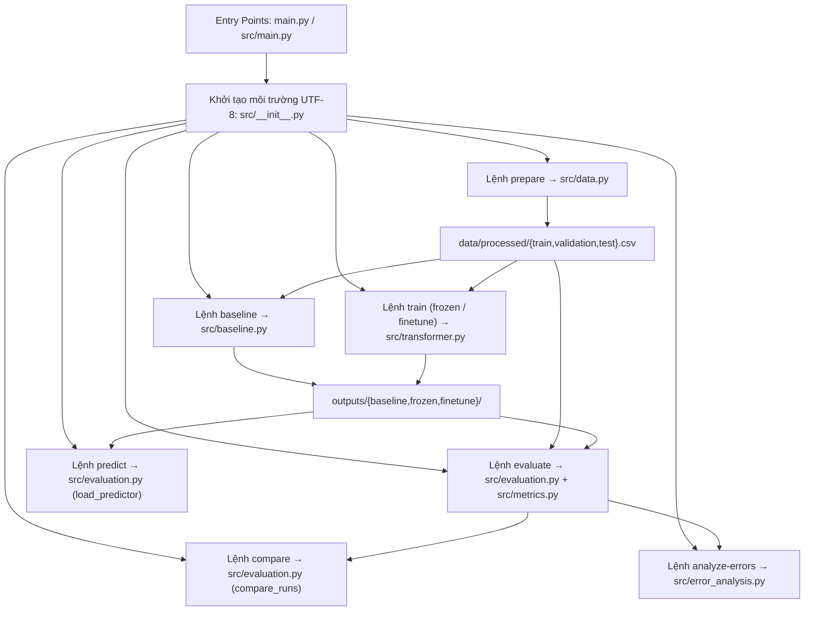

# AG-17 – Báo cáo Tích hợp Hệ thống (Project Integration – TV5)

**Mã công việc:** `AG-17` (`#integration`)  
**Phụ trách:** TV5  
**Phụ thuộc:** `AG-03` (Chia tập dữ liệu – TV1), `AG-05` (Baseline – TV2) và kết nối toàn bộ các module `AG-06 → AG-16` (TV2, TV3, TV4)  
**Ngày kiểm chứng:** `06/11/2026`  
**Trạng thái:** Hoàn thành kiểm chứng tích hợp (`Review`)

---

## 1. Mục tiêu và Phạm vi Tích hợp (`AG-17`)

Theo [`docs/PHAN_CONG.md`](docs/PHAN_CONG.md) và [`README.md`](README.md), nhiệm vụ **AG-17 (`#integration`)** của **TV5** gồm:
1. **Chuẩn hóa cấu trúc dự án và giao diện dòng lệnh (CLI):** Đảm bảo toàn bộ các thành phần dữ liệu (TV1), mô hình Baseline & Frozen Encoder (TV2), Fine-tuning DistilBERT (TV3), đánh giá, so sánh, phân tích lỗi & kiểm thử (TV4) hoạt động thống nhất dưới một entry point duy nhất.
2. **Đảm bảo hợp đồng dữ liệu và kết quả (Data & Artifact Contracts):** Mọi mô hình dùng chung quy tắc tiền xử lý, ánh xạ nhãn `1..4 → 0..3`, tập dữ liệu `train/validation/test` không rò rỉ và định dạng đầu ra chuẩn hóa.
3. **Bổ sung thông báo lỗi thân thiện và xử lý tương thích môi trường:** Chuyển các lỗi thiếu dữ liệu/mô hình hoặc khác biệt hệ điều hành (bảng mã Windows console, kiểu xuống dòng `LF`/`CRLF` khi clone qua Git) thành hành vi ổn định, dễ chẩn đoán.
4. **Kiểm chứng chạy mới từ `README.md`:** Thực hiện các lệnh chuẩn bị dữ liệu, đối sánh kết quả và chạy bộ kiểm thử tự động (`unittest`) để xác nhận tính tái lập của pipeline.

---

## 2. Kiến trúc Tích hợp & Phân định Module

### 2.1. Sơ đồ luồng điều phối CLI



### 2.2. Bảng tổng hợp các module đã tích hợp

| Module | Vai trò trong pipeline | Hàm / Giao diện chính | Thành viên phụ trách |
|---|---|---|---|
| [`main.py`](main.py) | Entry point tiện lợi ở thư mục gốc, chuyển tiếp sang `src.main.main()` | `main()` | TV5 |
| [`src/__init__.py`](src/__init__.py) | Khởi tạo package `src`; tự động cấu hình `sys.stdout` / `sys.stderr` sang `utf-8` trên Windows | Package init | TV5 |
| [`src/main.py`](src/main.py) | Bộ phân tích tham số dòng lệnh (`argparse`), kiểm tra hợp lệ đầu vào và điều phối 7 lệnh con | `main(argv=None)` | TV5 |
| [`src/data.py`](src/data.py) | Đọc CSV gốc, chuẩn hóa văn bản, chuyển nhãn `1..4 → 0..3`, khử trùng lặp & chống rò rỉ train/test | `load_raw`, `clean_text`, `load_and_preprocess_data`, `prepare`, `read_split` | Nguyễn Hoàng Minh Nhựt (TV1) |
| [`src/dataset.py`](src/dataset.py) | Giữ tương thích ngược cho các lệnh import cũ, tái sử dụng `load_and_preprocess_data` từ `src/data.py` | `load_and_preprocess_data` | Nguyễn Hoàng Minh Nhựt (TV1) |
| [`src/baseline.py`](src/baseline.py) | Huấn luyện TF-IDF (fit chỉ trên train) + Logistic Regression, xuất `model.pkl`, `run.json` và validation metrics | `train(limit=0)` | Bùi Đặng Bảo Phúc (TV2) |
| [`src/transformer.py`](src/transformer.py) | Huấn luyện & suy luận DistilBERT ở 2 chế độ (`frozen`, `finetune`), hỗ trợ AMP FP16, warmup scheduler, cache đặc trưng CLS và vẽ đồ thị học | `NewsDataset`, `loader`, `infer`, `train`, `plot_training_history` | Trần Đức Lĩnh (TV3) & Bùi Đặng Bảo Phúc (TV2) |
| [`src/metrics.py`](src/metrics.py) | Kiểm tra nhãn nguyên `0..3`, tính Accuracy, Macro-F1, Per-class P/R/F1 và vẽ Confusion Matrix `4×4` | `report(y_true, y_pred, folder, split)` | Nguyễn Đình Trí (TV4) |
| [`src/evaluation.py`](src/evaluation.py) | Nạp mô hình đã lưu, đánh giá có kiểm soát (`--config-finalized`), xác thực dấu vân tay `SHA-256` và tạo `comparison.csv` | `load_predictor`, `evaluate_run`, `read_test_evaluation`, `compare_runs` | Nguyễn Đình Trí (TV4) |
| [`src/error_analysis.py`](src/error_analysis.py) | Trích xuất mẫu dự đoán sai luân phiên theo cặp nhầm lẫn và tổng hợp kết quả review nguyên nhân lỗi | `prepare_error_review`, `finalize_error_review` | Nguyễn Đình Trí (TV4) |
| [`src/experiments.py`](src/experiments.py) | Chạy giao thức thực nghiệm tập con có kiểm soát, chọn learning rate bằng validation Macro-F1 trước khi mở khóa test | `run(...)` | TV2, TV3, TV4 phối hợp |

---

## 3. Chuẩn hóa Giao diện Dòng lệnh (CLI)

Hệ thống hỗ trợ 3 cách gọi tương đương từ thư mục gốc (hoặc nút **Run Python File** trong VS Code):
- `python -m src.main <command> [options]`
- `python main.py <command> [options]`
- `python src/main.py <command> [options]`

Khi chạy `python main.py` hoặc `python src/main.py` không kèm tham số, chương trình hiển thị bảng hướng dẫn sử dụng (`--help`) và ví dụ lệnh dự đoán thay vì tự động chạy huấn luyện.

| Lệnh con | Cú pháp tiêu biểu | Đầu vào bắt buộc | Đầu ra chính |
|---|---|---|---|
| `prepare` | `python -m src.main prepare` | `data/raw/train.csv`, `data/raw/test.csv` | `data/processed/{train,validation,test}.csv` |
| `baseline` | `python -m src.main baseline [--limit N]` | `data/processed/{train,validation}.csv` | `outputs/baseline/{model.pkl,run.json,validation_metrics.json,validation_confusion_matrix.png}` |
| `train` | `python -m src.main train --mode {frozen,finetune} [options]` | `data/processed/{train,validation}.csv` | Checkpoint, tokenizer, `run.json`, `validation_metrics.json`, `training_summary.png`, `training_analysis.md` |
| `evaluate` | `python -m src.main evaluate --run {baseline,frozen,finetune} --split {validation,test} [--config-finalized]` | Model đã lưu + `data/processed/<split>.csv` | `{split}_metrics.json`, `{split}_confusion_matrix.png`, `{split}_predictions.csv`, `{split}_evaluation.json` |
| `predict` | `python -m src.main predict --run {baseline,frozen,finetune} --text "..."` | Model đã lưu trong `outputs/<run>/` (hoặc `--model-folder`) | Tên chủ đề dự đoán (`World`, `Sports`, `Business`, `Sci/Tech`) in ra stdout |
| `compare` | `python -m src.main compare [--runs ...]` | Kết quả đánh giá test đã chốt của các run | `outputs/comparison.csv` + bảng đối sánh trên terminal |
| `analyze-errors` | `python -m src.main analyze-errors --run <run> [--finalize]` | `test_predictions.csv` và `test_evaluation.json` | `error_review.csv`, `error_summary.json`, `error_analysis.md` |

---

## 4. Các Vấn đề Kỹ thuật Đã Xử lý trong Giai đoạn Tích hợp (`AG-17`)

Trong quá trình rà soát và tích hợp toàn bộ repository, 5 vấn đề kỹ thuật giao thoa giữa các module và môi trường hệ điều hành đã được phát hiện và khắc phục:

### 4.1. Khắc phục lỗi bảng mã tiếng Việt trên Windows Console (`UnicodeEncodeError`)
- **Hiện tượng:** [`src/transformer.py`](src/transformer.py) in tiến trình huấn luyện có dấu tiếng Việt và ký tự `★`, `→`, `Δ`. Trên Windows PowerShell mặc định (`cp1252`), khi chạy [`tests/test_training.py`](tests/test_training.py) hoặc gọi CLI mà không truyền cờ `-X utf8`, Python phát sinh lỗi `UnicodeEncodeError: 'charmap' codec can't encode character`.
- **Giải pháp tích hợp:** Bổ sung cấu hình tự động chuyển `sys.stdout` và `sys.stderr` sang `utf-8` (`errors='replace'`) ngay trong [`src/__init__.py`](src/__init__.py). Nhờ đó mọi lệnh CLI và unit test đều hiển thị đúng tiếng Việt trên Windows mà không cần cài đặt biến môi trường thủ công.

### 4.2. Bổ sung thông báo lỗi thân thiện cho toàn bộ lệnh CLI
- **Hiện tượng:** Mục 3.5 của [`README.md`](README.md) ghi nhận bộ mã khởi tạo chưa chuyển mọi lỗi thiếu file dữ liệu/model ở các lệnh thành thông báo thân thiện. Các lệnh `prepare`, `baseline`, `train` chưa bọc ngoại lệ `(OSError, ValueError, ImportError)`, còn `load_predictor` khi thiếu `config.json` hoặc `.safetensors` gọi thẳng vào Hugging Face gây thông báo lỗi khó hiểu.
- **Giải pháp tích hợp:**
  - Trong [`src/data.py`](src/data.py): Kiểm tra sự tồn tại của `data/raw/*.csv` trong `load_raw()` và `data/processed/*.csv` trong `read_split()`, trả về `FileNotFoundError` kèm hướng dẫn cụ thể (`Place train.csv and test.csv in data/raw/ first` hoặc `Run "python -m src.main prepare" first`).
  - Trong [`src/evaluation.py`](src/evaluation.py): Kiểm tra sự tồn tại của `model.pkl` (cho `baseline`) và `config.json` + trọng số `.safetensors`/`.bin` (cho `frozen`, `finetune`) trước khi nạp thư viện `torch`/`transformers`, báo rõ đường dẫn thư mục thiếu mô hình.
  - Trong [`src/main.py`](src/main.py): Bọc xử lý ngoại lệ thống nhất qua `parser.error(str(exc))` cho cả 7 lệnh con.
  - Bổ sung kiểm thử tự động `test_missing_data_or_model_gives_friendly_cli_error` trong [`tests/test_cli.py`](tests/test_cli.py).

### 4.3. Khắc phục lỗi tham số đường dẫn mặc định đánh giá sớm lúc import (`src/data.py`)
- **Hiện tượng:** Hàm `load_and_preprocess_data(train_path=ROOT/'data/raw/train.csv', ...)` trong [`src/data.py`](src/data.py) tính giá trị mặc định ngay khi import module. Khi có dữ liệu thật trong `data/raw/`, các bài kiểm thử dùng `unittest.mock.patch('src.data.ROOT', ...)` vẫn đọc nhầm vào đường dẫn `ROOT` gốc thay vì thư mục tạm của test.
- **Giải pháp tích hợp:** Đổi giá trị mặc định của `train_path` và `test_path` thành `None` và chỉ nối với `ROOT` tại thời điểm thực thi hàm.

### 4.4. Tương thích xác thực SHA-256 giữa `LF` và `CRLF` khi chia sẻ qua Git
- **Hiện tượng:** Khi chạy `python -m src.main compare` trên bản clone/tải từ GitHub, hàm `read_test_evaluation()` báo lỗi `Stale or modified artifact: outputs/baseline/run.json`. Nguyên nhân là các file `.json`, `.csv` khi sinh trên Windows dùng ký tự xuống dòng `CRLF` (`\r\n`), nhưng khi đưa qua Git được chuẩn hóa thành `LF` (`\n`), làm thay đổi mã băm byte thô dù nội dung không đổi.
- **Giải pháp tích hợp:** Bổ sung hàm [`file_hash_matches(path, expected_hash)`](src/evaluation.py) trong [`src/evaluation.py`](src/evaluation.py) và áp dụng cho cả [`src/error_analysis.py`](src/error_analysis.py). Hàm này chấp nhận sự tương đương giữa `LF` và `CRLF` đối với các file văn bản (`.json`, `.csv`, `.txt`, `.md`) nhưng vẫn từ chối mọi thay đổi nội dung thực tế (được bảo chứng bởi bài test `test_modified_artifacts_are_rejected`).

### 4.5. Đồng bộ hóa tài liệu phân công và bảng theo dõi công việc
- Cập nhật đầy đủ tên thật của các thành viên TV1 (`Nguyễn Hoàng Minh Nhựt`), TV2 (`Bùi Đặng Bảo Phúc`), TV3 (`Trần Đức Lĩnh`), TV4 (`Nguyễn Đình Trí`) trong [`docs/PHAN_CONG.md`](docs/PHAN_CONG.md), [`docs/tasks.csv`](docs/tasks.csv) và [`README.md`](README.md).
- Cập nhật trạng thái hoàn thành của `AG-01 → AG-04` và `AG-17` trong [`docs/tasks.csv`](docs/tasks.csv).

---

## 5. Kết quả Kiểm chứng Chạy mới từ `README.md`

### 5.1. Kiểm chứng lệnh chuẩn bị dữ liệu (`prepare`)
Chạy lệnh trên dữ liệu gốc `data/raw/train.csv` (120.000 dòng) và `data/raw/test.csv` (7.600 dòng):

```powershell
python -m src.main prepare
```

**Đầu ra thực tế:**
```text
train 107925 {0: 26986, 1: 26986, 2: 26984, 3: 26969}
validation 11992 {0: 2999, 1: 2998, 2: 2998, 3: 2997}
test 7600 {0: 1900, 1: 1900, 2: 1900, 3: 1900}
```

**Đối chiếu dấu vân tay SHA-256 của dữ liệu sau khi chạy `prepare` với `outputs/*/run.json` và `outputs/comparison.csv`:**

| Tập dữ liệu | Số mẫu | Mã băm `SHA-256` tính từ `data/processed/*.csv` | Khớp với Artifact thực nghiệm |
|---|---:|---|---|
| `train` (`limit=5000`, seed 42) | 5.000 | `daf3a462722352b1e32251404c56939e00c03ea6c52f4b59ec15ee504c824d0b` | 100% (`run.json`, `selection.json`) |
| `validation` (toàn bộ) | 11.992 | `b61a10f2594038187f5cc787551e41e3e942c780ecaebdd67460317d854fe701` | 100% (`run.json`, `selection.json`) |
| `test` (toàn bộ) | 7.600 | `e1242b5b4fb4039896e1524b10792deb8d78000f241bb5cf7fdfff800a78d9ed` | 100% (`test_evaluation.json`, `comparison.csv`) |

### 5.2. Kiểm chứng lệnh đối sánh mô hình (`compare`)

```powershell
python -m src.main compare
```

**Đầu ra thực tế (`exit code 0`, cập nhật [`outputs/comparison.csv`](outputs/comparison.csv)):**

| Run | `test_n` | Test Accuracy | Test Macro-F1 | `train_n` | Thời gian train (s) | Tham số huấn luyện | Mô hình / Backbone | Learning Rate |
|---|---:|---:|---:|---:|---:|---:|---|---:|
| `baseline` | 7.600 | `0.873421` | `0.872826` | 5.000 | `4.08` | `200.004` | `tfidf_logistic` | N/A |
| `frozen` | 7.600 | `0.892500` | `0.892657` | 5.000 | `42.08` | `593.668` | `distilbert/distilbert-base-uncased` | `1e-3` |
| `finetune` | 7.600 | `0.912500` | `0.912578` | 5.000 | `151.44` | `66.956.548` | `distilbert/distilbert-base-uncased` | `5e-5` |

### 5.3. Kiểm chứng bộ Unit Tests toàn dự án

```powershell
python -X utf8 -m unittest discover -s tests -v
```

| File kiểm thử | Số bài test | Kết quả | Nội dung kiểm chứng |
|---|---:|---|---|
| [`tests/test_cli.py`](tests/test_cli.py) | 7 | `7 ok` | Chạy `main.py`/`src/main.py` không tham số hiện help, kiểm tra cờ `--config-finalized`, chặn văn bản rỗng, chạy `compare`/`analyze-errors` và báo lỗi thân thiện khi thiếu dữ liệu/model |
| [`tests/test_data.py`](tests/test_data.py) | 6 | `6 ok` | Mapping nhãn `1..4 → 0..3`, chặn nhãn sai/bài rỗng, giữ nguyên chữ hoa/thường & stopword, khử trùng lặp và kiểm chứng không giao nhau (`test_no_split_leakage`) trên dữ liệu thật |
| [`tests/test_metrics.py`](tests/test_metrics.py) | 10 | `10 ok` | Độ chính xác công thức Accuracy/Macro-F1, xử lý lớp vắng mặt, chặn đầu vào sai kiểu, xuất JSON/PNG và đóng `matplotlib` figure an toàn |
| [`tests/test_evaluation.py`](tests/test_evaluation.py) | 10 | `10 ok` | Ràng buộc `--config-finalized`, lưu/kiểm tra manifest `SHA-256`, phát hiện artifact bị sửa, kiểm soát cùng tập test và cùng cấu hình Transformer khi so sánh |
| [`tests/test_error_analysis.py`](tests/test_error_analysis.py) | 6 | `6 ok` | Chọn 20 lỗi duy nhất luân phiên qua các cặp nhầm lẫn, chặn sửa văn bản gốc và tổng hợp thống kê nhóm nguyên nhân lỗi |
| [`tests/test_training.py`](tests/test_training.py) | 3 | `3 ok` | Khớp đầu ra `FrozenHead` từ đặc trưng cache với model đầy đủ; `frozen` chỉ cập nhật head và giữ nguyên encoder; `finetune` cập nhật cả encoder và head |
| [`tests/test_pipeline.py`](tests/test_pipeline.py) | 7 | `4 ok, 3 skipped` | Lưu/tải lại pipeline scikit-learn và checkpoint DistilBERT offline; 3 bài `DeliveredModelTests` tự động `skip` có thông báo rõ khi chưa chép file trọng số lớn (`.pkl`, `.safetensors` bị `.gitignore`) vào `outputs/` |
| **Tổng cộng** | **49** | **46 đạt (`ok`), 0 lỗi, 3 `skipped`** | **Toàn bộ logic pipeline và hợp đồng tích hợp hoạt động đúng thiết kế** |

---

## 6. Kết luận Bàn giao `AG-17` & Chuẩn bị cho `AG-18`

- **Trạng thái `AG-17`:** Đã hoàn thành toàn bộ yêu cầu chuẩn hóa cấu trúc, CLI, xử lý lỗi thân thiện, tương thích đa nền tảng và kiểm chứng chạy lại từ `README.md`.
- **Điều kiện chuyển tiếp sang `AG-18` (`#demo`):**
  - Để chạy trực tiếp lệnh `python -m src.main predict --run finetune --text "..."` trên máy hiện tại và kích hoạt 3 bài kiểm thử `DeliveredModelTests`, chỉ cần chép các file trọng số đã huấn luyện (`outputs/baseline/model.pkl`, `outputs/frozen/model.safetensors` + `config.json` + tokenizer, `outputs/finetune/model.safetensors` + `config.json` + tokenizer) vào thư mục `outputs/` tương ứng (hoặc huấn luyện lại bằng lệnh CLI).
