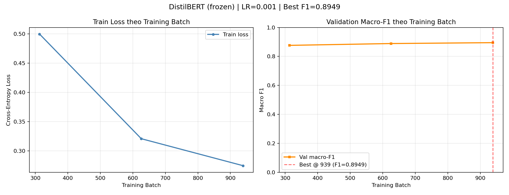
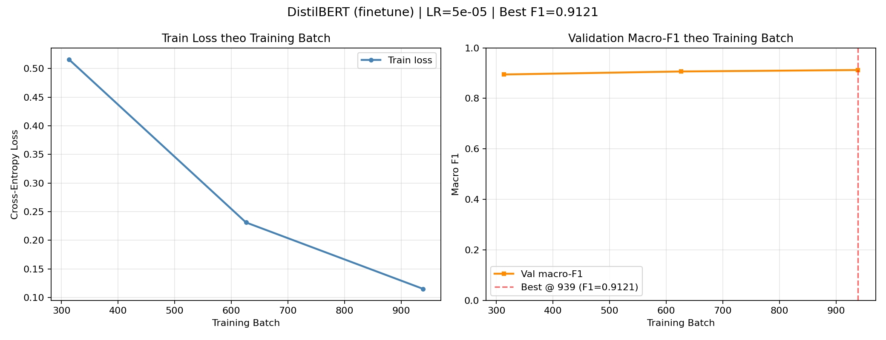

# Kết quả thực nghiệm tập con – 05/11/2026

Đã huấn luyện và đánh giá **model thật**, dùng cùng **5.000 mẫu train**, seed 42,
validation 11.992 mẫu và test 7.600 mẫu. Transformer chạy 3 epoch, max length
128, batch 16. Đây là kết quả trên tập con train, không phải kết quả huấn luyện
toàn bộ AG News. Phương pháp và lệnh tái hiện ở [TRAINING.md](TRAINING.md).

## Chọn cấu hình trước khi đọc test

| Phương pháp | Learning rate | Validation macro-F1 cao nhất | Chọn |
|---|---:|---:|---|
| Frozen | 1e-3 | 0.894880 | Có |
| Frozen | 5e-4 | 0.894293 | |
| Fine-tuning | 2e-5 | 0.911828 | |
| Fine-tuning | 5e-5 | 0.912148 | Có |

Cả bốn lượt đạt validation F1 cao nhất ở epoch 3. Chênh lệch giữa hai LR của
cùng phương pháp nhỏ; một seed chưa đủ để kết luận ưu thế có ý nghĩa thống kê.
Baseline dùng cấu hình TF-IDF/Logistic Regression cố định, không thử LR.
Fine-tuning được chọn làm model phân tích lỗi vì có validation macro-F1 cao
nhất trong ba phương pháp, trước khi đọc test.

Lựa chọn được lưu tại [selection.json](../outputs/selection.json),
[lr_comparison.json](../outputs/lr_comparison.json) và
[final_evaluation_protocol.json](../outputs/final_evaluation_protocol.json).
Protocol cuối ghi SHA-256 cấu hình trước đánh giá test. Test không được dùng
để chọn lại LR hoặc checkpoint.

## AG-14 – So sánh trên cùng test

| Model | Validation Accuracy | Validation macro-F1 | Test Accuracy | Test macro-F1 |
|---|---:|---:|---:|---:|
| TF-IDF + Logistic Regression | 0.879086 | 0.878600 | 0.873421 | 0.872826 |
| DistilBERT frozen, LR 1e-3 | 0.894763 | 0.894880 | 0.892500 | 0.892657 |
| DistilBERT fine-tuning, LR 5e-5 | 0.912108 | 0.912148 | 0.912500 | 0.912578 |

Nguồn: [validation_comparison.csv](../outputs/validation_comparison.csv),
[comparison.csv](../outputs/comparison.csv). Cả ba manifest test cùng SHA-256
`e1242b5b4fb4039896e1524b10792deb8d78000f241bb5cf7fdfff800a78d9ed`.
Mỗi thư mục model có `test_metrics.json`, `test_predictions.csv`,
`test_confusion_matrix.png` và `test_evaluation.json` chứa nguồn kết quả.

Trong đợt này, fine-tuning có test macro-F1 cao hơn frozen khoảng **1.99 điểm
phần trăm**, và cao hơn baseline khoảng **3.98 điểm phần trăm**. Chưa có nhiều
seed hoặc khoảng tin cậy để khái quát kết luận ra các lần chạy khác.

| Lớp | Baseline F1 | Frozen F1 | Fine-tuning F1 | Support test |
|---|---:|---:|---:|---:|
| World | 0.879531 | 0.893952 | 0.917451 | 1900 |
| Sports | 0.933061 | 0.971279 | 0.972789 | 1900 |
| Business | 0.835749 | 0.842806 | 0.876975 | 1900 |
| Sci/Tech | 0.842962 | 0.862589 | 0.883096 | 1900 |

Sports có F1 cao nhất ở cả ba model trong đợt này. Business và Sci/Tech vẫn là
hai lớp khó hơn theo F1 và các cặp nhầm lẫn của fine-tuning.

## AG-08/AG-11 – Tham số, thời gian và bộ nhớ

| Model được chọn | Tham số được tối ưu | Thời gian ghi nhận (giây) | Thiết bị | Peak tensor CUDA (MiB) |
|---|---:|---:|---|---:|
| Baseline | 200004 | 4.08 | CPU | Không áp dụng |
| Frozen | 593668 | 42.08 | RTX 4060 Laptop GPU | 338.66 |
| Fine-tuning | 66956548 | 151.44 | RTX 4060 Laptop GPU | 1325.19 |

Baseline chỉ đếm hệ số/bias Logistic Regression, không đếm vocabulary và IDF.
Frozen chỉ tối ưu head, giảm số tham số cần gradient; vẫn phải lưu encoder đầy
đủ và tính encoder khi suy luận. Fine-tuning có thể thích nghi biểu diễn với
bài toán nhưng cần gradient và bộ nhớ cho toàn bộ model.

Thời gian là số đo đồng hồ trong phiên chạy, gồm phạm vi được ghi ở `run.json`,
không gồm tải trọng số. Lượt frozen LR 5e-4 chỉ tốn 11.81 giây vì tái sử dụng
đặc trưng đã mã hóa từ lượt đầu (30.37 giây mã hóa). Lượt fine-tuning LR 2e-5
ghi nhận 980.96 giây, còn LR 5e-5 ghi nhận 151.44 giây; **không quy chênh lệch
này cho learning rate**, vì chưa có benchmark kiểm soát tải hệ thống và các lần
lặp. CPU/GPU cũng khác nhau giữa baseline và Transformer. Peak tensor CUDA là
bộ nhớ PyTorch cấp phát, không phải tổng VRAM của máy.

[encoder_checks.json](../outputs/encoder_checks.json) so sánh SHA-256 nội dung
từng tensor encoder với checkpoint gốc: frozen giữ nguyên **100/100 tensor**;
fine-tuning thay đổi **100/100 tensor**. Kiểm thử nhỏ còn kiểm tra head thay đổi
và encoder frozen ở chế độ không học.

## AG-12 – Đường học

Fine-tuning LR được chọn giảm train loss qua các epoch
`0.516297 → 0.231068 → 0.114928`; validation macro-F1 tăng
`0.894477 → 0.906353 → 0.912148`. Frozen LR được chọn giảm loss
`0.499957 → 0.320827 → 0.274659`, với validation F1
`0.876215 → 0.888793 → 0.894880`.
Ba mốc chưa chứng minh đã hội tụ hoặc không overfit; đây chỉ là xu hướng quan
sát trong ngân sách 3 epoch đã chốt.





Lịch sử riêng từng LR ở `outputs/experiments/`; nhận xét đi kèm trong
`training_analysis.md`, dữ liệu nguồn trong `run.json`.

## AG-15 – Đọc 20 lỗi thật của fine-tuning

Fine-tuning sai **665/7600 mẫu**. Hai cặp lớn nhất là Sci/Tech → Business
**165 mẫu** và Business → Sci/Tech **151 mẫu**, tổng **316/665 lỗi**.
Đã chọn 20 mẫu duy nhất luân phiên giữa 12 cặp nhầm lẫn, seed 42, và đọc toàn
bộ văn bản được cung cấp của từng mẫu.

| Nhóm được đề xuất | Số mẫu trong 20 mẫu |
|---|---:|
| Chủ đề chồng lấn | 10 |
| Nghi vấn nhãn nguồn | 4 |
| Thiếu ngữ cảnh | 4 |
| Tín hiệu thực thể dễ nhầm | 2 |

Ví dụ: ID 5431 nói Vodafone cung cấp 3G nên chứa cả tín hiệu kinh doanh và công
nghệ; ID 7278 nói trần lương NHL nên chồng lấn thể thao/tài chính; ID 3186 có nội
dung Tennis/Australian Open nhưng nhãn nguồn World, cần đối chiếu nguồn.
Các giải thích là **giả thuyết định tính do Codex đề xuất sau khi đọc nội dung**,
chưa xác minh nguyên nhân bằng cơ chế model và chưa được thành viên nhóm review.
Không sửa nhãn thật và không dùng lỗi test để chọn lại cấu hình.

Cả 20 mẫu có 27–123 token gồm special tokens, đều không vượt max length 128;
không có cơ sở quy lỗi trong mẫu này cho truncation của tokenizer. Các đoạn
trích nguồn vốn ngắn hoặc có dấu lược vẫn có thể thiếu ngữ cảnh. Mẫu lấy theo
cặp nhầm lẫn nên tỷ lệ nhóm không đại diện cho toàn bộ test.

Chi tiết từng ID, văn bản, nhãn và giải thích:
[error_review.csv](../outputs/finetune/error_review.csv),
[error_analysis.md](../outputs/finetune/error_analysis.md),
[error_summary.json](../outputs/finetune/error_summary.json).
Trạng thái `reviewed` xác nhận đủ 20 chú giải hợp lệ; không thay thế review
độc lập của nhóm.

## AG-16 – Kiểm thử và phần bàn giao còn lại

Đã chạy trong môi trường CUDA của project:

```powershell
.\.venv-gpu\Scripts\python.exe -m unittest discover -s tests -v
```

Kết quả: **46 bài, 46 đạt, 0 skip**, 23.837 giây. Có kiểm thử mapping, không
giao text giữa các split, metrics/JSON/PNG, nguồn kết quả, chọn/review lỗi,
cache/head, cập nhật encoder và tải lại đủ ba model thật. Mỗi model thật trả
đầu ra ổn định cho tám câu demo thuộc bốn chủ đề; không dùng demo làm phép đo
accuracy. Kiểm thử nhãn mẫu/checkpoint ngẫu nhiên vẫn chỉ là fixture.

TV2/TV3/TV4 có thể bàn giao mã, model và kết quả tập con cho nhóm review.
Nhóm còn cần kiểm tra độc lập 20 chú giải lỗi và nghi vấn nhãn nguồn, xác nhận
kết quả chạy lại trên máy khác, đối chiếu audit/EDA của TV1 và hoàn thiện
demo/báo cáo/slide của TV5. Nếu yêu cầu toàn bộ train hoặc nhiều seed, đó là đợt thực nghiệm
mới với giao thức đánh giá được thống nhất riêng. Chưa commit hoặc push.
