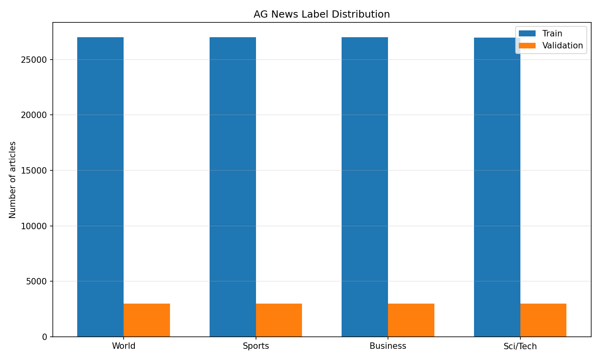
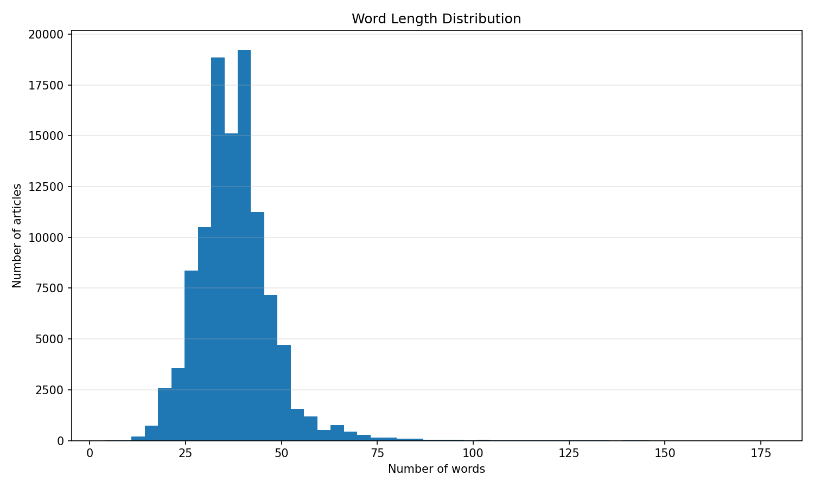
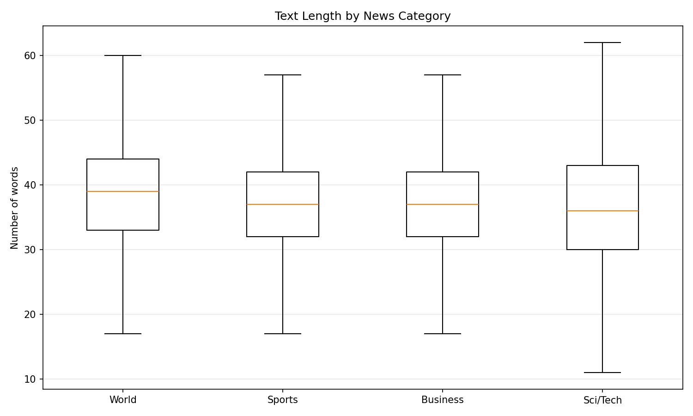
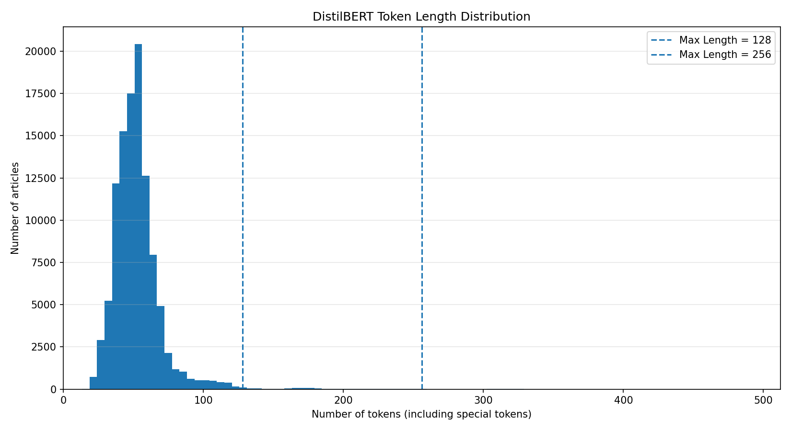
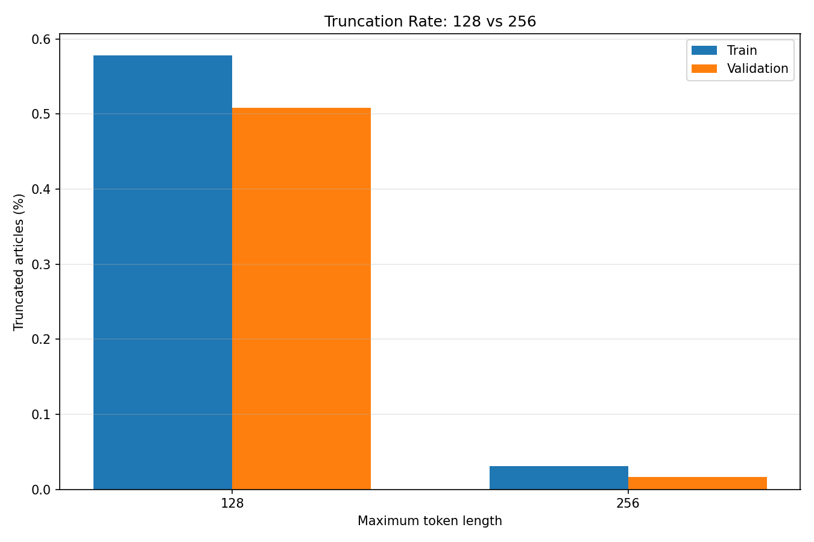

# AG News - Exploratory Data Analysis

## 1. Dataset Overview

| Split | Samples |
|---|---:|
| Train | 107,925 |
| Validation | 11,992 |

## 2. Label Distribution

| Category | Train | Validation |
|---|---:|---:|
| World | 26,986 | 2,999 |
| Sports | 26,986 | 2,998 |
| Business | 26,984 | 2,998 |
| Sci/Tech | 26,969 | 2,997 |

## 3. Text Length Analysis

| Statistic | Word Count | Character Count |
|---|---:|---:|
| Mean | 37.84 | 235.24 |
| Median | 37.00 | 231.00 |
| P90 | 48.00 | 298.00 |
| P95 | 53.00 | 338.00 |
| P99 | 70.00 | 459.00 |
| Maximum | 177.00 | 976.00 |

### 3.1 Length by Category

| Category | Mean Words | Median Words | Maximum Words |
|---|---:|---:|---:|
| World | 38.92 | 39 | 145 |
| Sports | 37.76 | 37 | 151 |
| Business | 37.52 | 37 | 134 |
| Sci/Tech | 37.19 | 36 | 177 |

## 4. Token Length and Truncation

Tokenizer: `distilbert/distilbert-base-uncased`

Token counts include special tokens added by the tokenizer.

| Split | Max Length | Truncated Articles | Truncated (%) | Discarded Tokens | Discarded (%) |
|---|---:|---:|---:|---:|---:|
| train | 128 | 624 | 0.58% | 30,071 | 0.55% |
| train | 256 | 33 | 0.03% | 1,514 | 0.03% |
| validation | 128 | 61 | 0.51% | 2,632 | 0.43% |
| validation | 256 | 2 | 0.02% | 48 | 0.01% |

## 5. Observations

## 5. Findings and Recommendations

### 5.1 Label Distribution

The training and validation datasets maintain similar class proportions through stratified sampling.
No significant class imbalance was observed.

### 5.2 Text Length Distribution

- Average article length: 37.84 words.
- Median article length: 37 words.
- P95 article length: 53 words.
- Average character count: 235.24.

The distribution is right-skewed, indicating that most articles are relatively short, while a small number contain substantially more text.

### 5.3 Length by Category

- Category with highest average word count: World.
- Category with longest individual article: Sci/Tech.

Average word lengths are relatively similar across the four news categories.

### 5.4 Tokenization and Truncation

- Training average token length: 52.74.
- Training P99 token length: 117.

- Train truncation at 128: 0.58%.
- Train truncation at 256: 0.03%.
- Validation truncation at 128: 0.51%.
- Validation truncation at 256: 0.02%.

Increasing max_length from 128 to 256 substantially reduces truncation.

### 5.5 Recommendation

A maximum sequence length of 128 is a reasonable starting configuration for DistilBERT.
It preserves more than 99.4% of training articles without truncation while reducing computational and memory requirements compared with 256.

However, the final configuration should be selected through validation experiments using Macro-F1 and resource consumption.

The test split was excluded from this analysis to avoid using test performance for model selection.

