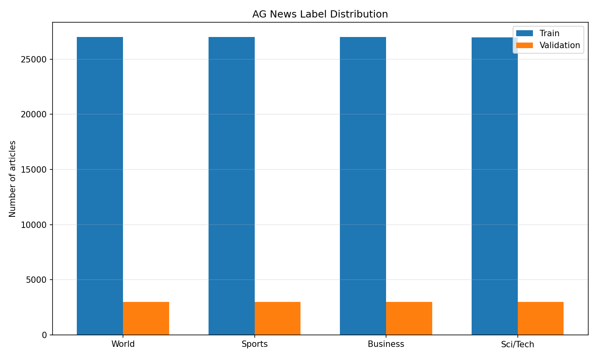
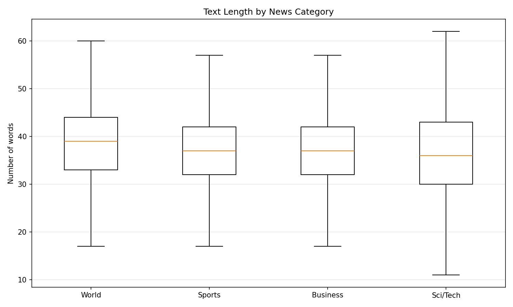
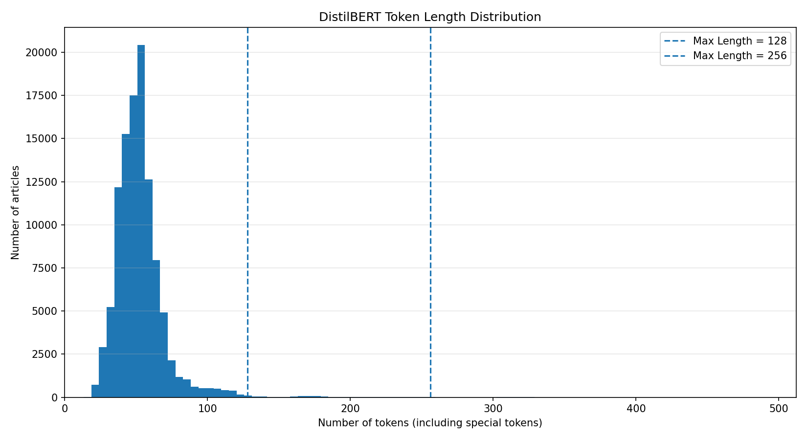
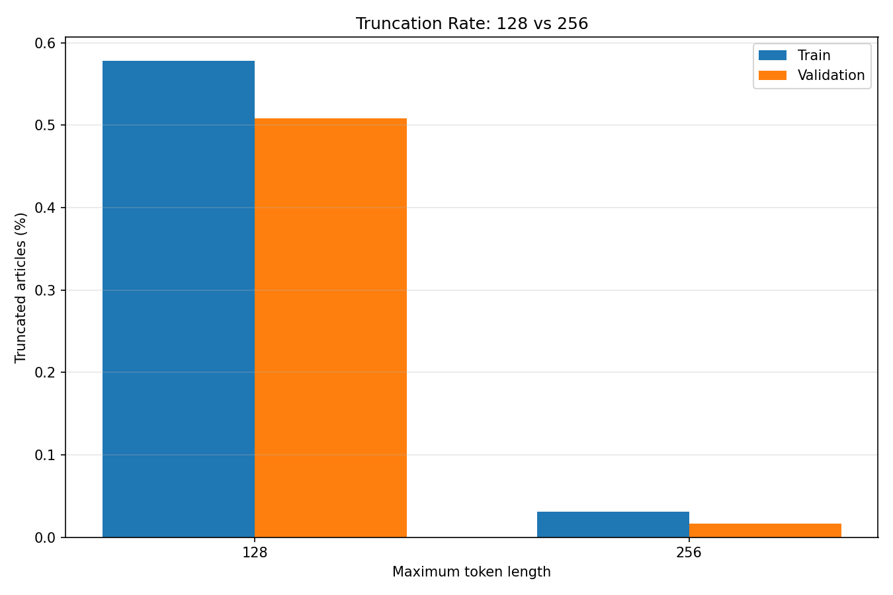
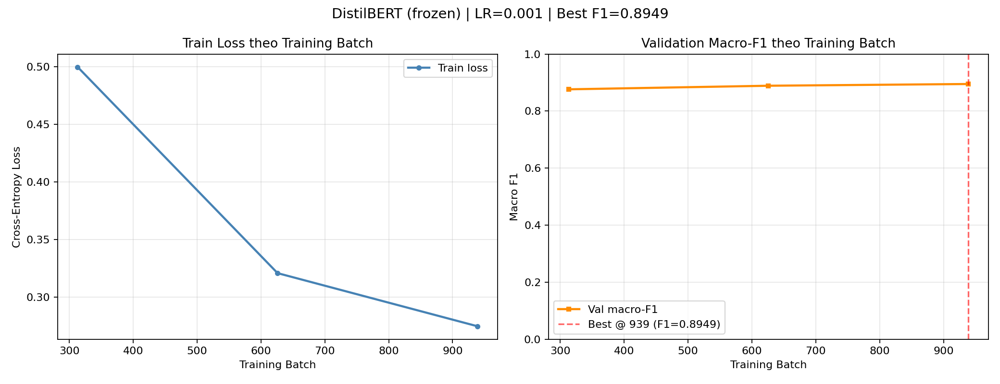
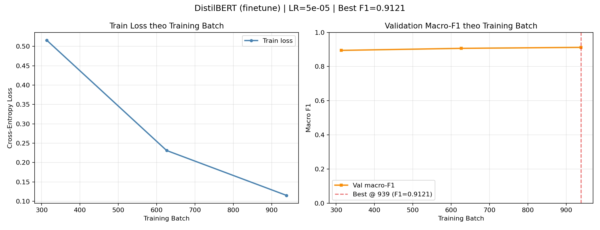
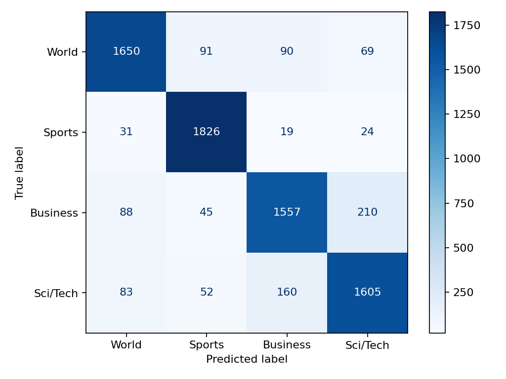
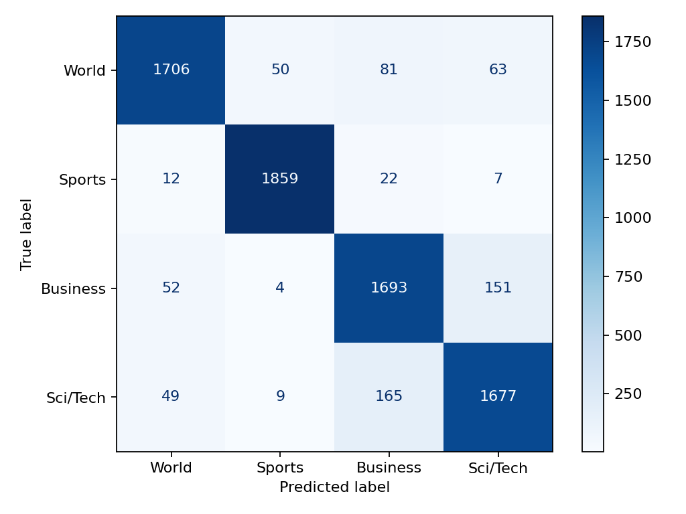

# Project Final Report: AG News Topic Classification with DistilBERT

**Project Title:** AG News – News Topic Classification (Comparing TF-IDF Baseline, Frozen DistilBERT Encoder, and Full Fine-tuning DistilBERT)  
**Report Date:** `2026-11-06`  
**Corresponding Vietnamese Report:** [`docs/report_vi.md`](report_vi.md)

---

## Team Members & Responsibilities

| Member ID | Full Name | Primary Role | Assigned Tasks | Report Sections Contributed |
|---|---|---|---|---|
| **TV1** | **Nguyễn Hoàng Minh Nhựt** | Data Audit, Preprocessing & Exploratory Data Analysis (EDA) | `AG-01 → AG-04` | Section 1, Section 2 ([`docs/data_audit.md`](data_audit.md), [`docs/eda.md`](eda.md)) |
| **TV2** | **Bùi Đặng Bảo Phúc** | Baseline (TF-IDF + Logistic Regression) & Frozen Encoder | `AG-05 → AG-08` | Section 3 ([`docs/TRAINING.md`](TRAINING.md), [`docs/BASELINE_NOTES.md`](BASELINE_NOTES.md)) |
| **TV3** | **Trần Đức Lĩnh** | Full Fine-tuning DistilBERT, Resource Optimization & Convergence Analysis | `AG-09 → AG-12` | Section 4 ([`docs/FINETUNING.md`](FINETUNING.md), [`outputs/finetune/training_analysis.md`](../outputs/finetune/training_analysis.md)) |
| **TV4** | **Nguyễn Đình Trí** | Evaluation Protocol, Test Comparison, Error Analysis & Unit Testing | `AG-13 → AG-16` | Section 5 ([`docs/EVALUATION.md`](EVALUATION.md), [`docs/RESULTS.md`](RESULTS.md), [`docs/ERROR_ANALYSIS.md`](ERROR_ANALYSIS.md)) |
| **TV5** | **Đỗ Hoàng Đăng** | System Integration, Prediction Demo, Report Compilation & Presentation | `AG-17 → AG-20` | Section 6 & Editorial Compilation ([`integration.md`](../integration.md), [`demo.md`](../demo.md)) |

---

## 1. Problem Formulation, Objectives, and Raw Data Audit (Owner: Nguyễn Hoàng Minh Nhựt – TV1)

### 1.1. Problem Statement and Core Research Question
Manually reading and categorizing hundreds of thousands of English news articles into editorial sections is time-consuming and prone to inconsistency when articles span multiple domains. This project builds an end-to-end machine learning pipeline to automatically classify English news items (combining `Title` and `Description`) into one of four canonical **AG News** categories:

| Raw `Class Index` | Internal `label` | Category Name (`LABELS`) | Editorial Scope |
|---:|---:|---|---|
| `1` | `0` | **World** | International affairs, politics, diplomacy, conflicts, and global events |
| `2` | `1` | **Sports** | Sporting events, tournaments, athletes, teams, and match outcomes |
| `3` | `2` | **Business** | Corporate news, finance, stock markets, economy, and trade |
| `4` | `3` | **Sci/Tech** | Science, technology, hardware, software, space, and environment |

**Core Research Question:**
> *Does full fine-tuning of `distilbert/distilbert-base-uncased` improve Macro-F1 over freezing the pretrained encoder (training only the classification head) by a margin large enough to justify the additional training time and GPU memory cost? Furthermore, how do both Transformer approaches compare against a classical TF-IDF + Logistic Regression baseline in accuracy-to-resource trade-offs?*

### 1.2. Raw Dataset Quality Audit (`AG-01` – Data Audit)
The data audit utility [`scripts/audit_data.py`](../scripts/audit_data.py) inspected the raw `data/raw/train.csv` and `data/raw/test.csv` splits without modifying the source files (full details in [`docs/data_audit.md`](data_audit.md)):

| Audit Criterion | Raw `train.csv` | Raw `test.csv` | Technical Observation & Impact |
|---|---:|---:|---|
| **Total rows (`Rows`)** | `120,000` | `7,600` | Standard AG News benchmark scale |
| **Columns (`Columns`)** | `3` (`Class Index`, `Title`, `Description`) | `3` (`Class Index`, `Title`, `Description`) | All required schema fields present |
| **Missing / Null values** | `0` | `0` | Zero null entries across all 3 columns |
| **Empty articles after normalization** | `0` | `0` | Every article contains valid text |
| **Labels outside `1..4`** | `0` | `0` | All raw labels are valid |
| **Class distribution (`World / Sports / Business / Sci/Tech`)** | `30,000` per class (`25.00%`) | `1,900` per class (`25.00%`) | Perfectly balanced across all 4 categories |
| **Exact duplicate CSV rows** | `0` | `0` | No rows are identical across all 3 raw columns |
| **Duplicate normalized texts (`Title + Description`)** | `79` groups (`79` extra rows) | `0` | `64` same-label duplicate groups and **`15` conflicting-label groups** |
| **Unique normalized texts** | `119,921` | `7,600` | Requires deduplication prior to splitting |
| **Cross-split overlap (`train ∩ test`)** | `4` articles (same label) | `4` articles (same label) | Potential **data leakage** if retained in `train` |

**Breakdown of the 15 conflicting-label duplicate groups in `train.csv`:**
- `Business` vs. `Sci/Tech`: **12 groups** (`80%` of all label conflicts, reflecting intrinsic topical ambiguity between technology business news and product/technology coverage).
- `World` vs. `Business`: **2 groups**.
- `World` vs. `Sci/Tech`: **1 group**.

---

## 2. Preprocessing, Exploratory Data Analysis (EDA), and Splitting (Owner: Nguyễn Hoàng Minh Nhựt – TV1)

### 2.1. Shared Text Normalization and Anti-Leakage Policy (`AG-02`, `AG-03`)
The module [`src/data.py`](../src/data.py) (along with its backward-compatible wrapper [`src/dataset.py`](../src/dataset.py)) enforces a single data contract across all models:
1. **Concatenation and light normalization (`clean_text`):** Joins `Title` and `Description` with a single space, decodes HTML entities via `html.unescape` (e.g., `&amp;` → `&`), and collapses consecutive whitespace (`\s+` → `' '`). Crucially, it **does not** strip stopwords, **does not** apply stemming/lemmatization, and **preserves original casing** at the shared preprocessing stage so contextual token sequences remain intact for DistilBERT.
2. **Label Mapping:** Maps `Class Index` from `1..4` to zero-based integers `0..3` corresponding to `['World', 'Sports', 'Business', 'Sci/Tech']`.
3. **Deduplication and Anti-Leakage Policy:**
   - Removes internal duplicate texts within `test` and within `train` keeping the first occurrence (`drop_duplicates('text')`).
   - Removes any `train` article whose normalized `text` appears in `test` (`train = train[~train.text.isin(test.text)]`), guaranteeing **0% data leakage** between training/validation and the held-out test set.
4. **Stratified `train / validation` Split:**
   - Splits the `119,917` clean training articles into `90%` `train` and `10%` `validation` using `random_state = 42` and `stratify = train.label`.

| Processed Split (`data/processed/`) | Total Samples | `World (0)` | `Sports (1)` | `Business (2)` | `Sci/Tech (3)` | Verified `SHA-256` Checksum |
|---|---:|---:|---:|---:|---:|---|
| **`train.csv`** (full clean split) | `107,925` | `26,986` | `26,986` | `26,984` | `26,969` | Full training pool |
| **`train` subset** (`limit=5000`, seed 42) | `5,000` | `1,250` | `1,250` | `1,250` | `1,250` | `daf3a462722352b1e32251404c56939e...` |
| **`validation.csv`** | `11,992` | `2,999` | `2,998` | `2,998` | `2,997` | `b61a10f2594038187f5cc787551e41e3...` |
| **`test.csv`** | `7,600` | `1,900` | `1,900` | `1,900` | `1,900` | `e1242b5b4fb4039896e1524b10792deb...` |

### 2.2. Exploratory Data Analysis and `max_length` Selection (`AG-04`)
The script [`scripts/eda.py`](../scripts/eda.py) analyzed `train` (`107,925` samples) and `validation` (`11,992` samples) without inspecting `test` (detailed report in [`docs/eda.md`](eda.md)):

- **Text Length Statistics on `train`:**
  - **Word Count:** Mean `37.84` words, median `37` words, `P90 = 48` words, `P95 = 53` words, `P99 = 70` words, maximum `177` words.
  - **Character Count:** Mean `235.24` characters, median `231` characters, `P95 = 338` characters, maximum `976` characters.
  - **Per-Class Word Length:** Uniform across all 4 topics: `World` (`38.92` words), `Sports` (`37.76` words), `Business` (`37.52` words), `Sci/Tech` (`37.19` words; longest single outlier at `177` words).

- **DistilBERT Token Length (`distilbert/distilbert-base-uncased`) and Truncation Analysis:**
  - Mean token length on `train` (including `[CLS]` and `[SEP]`): **`52.74` tokens**; 99th percentile (`P99`): **`117` tokens**.

| Dataset Split | `max_length` Threshold | Truncated Articles | Truncated Articles (`%`) | Total Clipped Tokens | Clipped Tokens (`%`) |
|---|---:|---:|---:|---:|---:|
| **`train`** | `128` | `624` | **`0.58%`** | `30,071` | `0.55%` |
| **`train`** | `256` | `33` | `0.03%` | `1,514` | `0.03%` |
| **`validation`** | `128` | `61` | **`0.51%`** | `2,632` | `0.43%` |
| **`validation`** | `256` | `2` | `0.02%` | `48` | `0.01%` |

> **Design Decision from EDA:** We selected **`max_length = 128`** for all DistilBERT experiments because it preserves **`99.42%`** of training articles completely intact (losing only `0.55%` of total tokens) while halving sequence length relative to `256`, substantially reducing GPU memory usage and Self-Attention compute time.

---

## 3. TF-IDF Baseline and Frozen DistilBERT Encoder (Owner: Bùi Đặng Bảo Phúc – TV2)

### 3.1. Controlled Experimental Protocol
To guarantee a fair, controlled comparison across all three model families on local hardware (Laptop GPU), the team enforced a unified experimental protocol in [`src/experiments.py`](../src/experiments.py) and [`docs/TRAINING.md`](TRAINING.md):
- **Shared Training Subset:** Identical stratified subset of **`5,000` training samples** (`read_split('train', 5000)`, `seed = 42`, `train_sha256 = daf3a462...`).
- **Model Selection Split:** Identical **`11,992` validation samples** (`validation_sha256 = b61a10f2...`). The sole criterion for hyperparameter and checkpoint selection is **Validation Macro-F1**.
- **Test Split Lock:** The `test` split (`7,600` samples) was evaluated exactly once after locking the final protocol in [`outputs/final_evaluation_protocol.json`](../outputs/final_evaluation_protocol.json) (`test_used_for_selection = false`).

### 3.2. Classical Baseline: TF-IDF + Logistic Regression (`AG-05`)
Implemented in [`src/baseline.py`](../src/baseline.py) as a two-stage `scikit-learn` pipeline:
1. **Feature Extraction (`TfidfVectorizer`):** `ngram_range = (1, 2)` (capturing both unigrams and bigrams such as `"stock market"` or `"world cup"`), `max_features = 50,000`, `sublinear_tf = True` ($1 + \log(\text{tf})$ to dampen repetitive term counts). Fitted strictly on the training split (`fit_transform(X_train)`), never on validation or test.
2. **Classifier (`LogisticRegression`):** `max_iter = 1000`, `random_state = 42`.
   - Total trainable linear parameters: $50,000 \times 4 + 4 = \mathbf{200,004}$ parameters.
   - CPU wall-clock execution time (fit + validation inference + saving `model.pkl`): **`4.08` seconds**.
   - Validation performance on the 5,000-sample protocol: Validation Accuracy = **`0.879086`**, Validation Macro-F1 = **`0.878600`**.
   - *(Reference note from [`docs/BASELINE_NOTES.md`](BASELINE_NOTES.md): In standalone full-scale experiments on the entire training split with `max_features=10,000`, TF-IDF + Logistic Regression reaches ~`0.9145` Validation Macro-F1. However, in the official controlled comparison below, all three approaches are evaluated on the exact same `5,000`-sample training subset).*

### 3.3. Frozen DistilBERT Encoder (`AG-06`, `AG-07`, `AG-08`)
In `--mode frozen` within [`src/transformer.py`](../src/transformer.py):
- **Encoder Freezing Mechanism:** All 6 Transformer layers in `distilbert/distilbert-base-uncased` have `p.requires_grad = False` and remain explicitly locked in `model.base_model.eval()` throughout training to disable encoder dropout.
- **Trainable Classification Head (`FrozenHead`):** Updates only the classification head (`pre_classifier: Linear(768 → 768) → ReLU → Dropout → classifier: Linear(768 → 4)`), totaling **`593,668` trainable parameters** (**`0.89%`** of the `66,956,548` total parameters).
- **CLS Feature Caching Optimization:** Because the frozen encoder is deterministic in `eval()` mode, the `768`-dimensional `[CLS]` representations for `train` and `validation` are extracted once on GPU (`30.37` seconds) and cached in memory across learning-rate trials, while the saved checkpoint remains a complete Hugging Face `DistilBertForSequenceClassification` model for downstream `evaluate` and `predict`.
- **Cryptographic Verification of Frozen Weights (`outputs/encoder_checks.json`):** Comparing SHA-256 digests across all `100` encoder parameter tensors against the base `distilbert-base-uncased` checkpoint (`revision = 12040acc...`) confirms **`100/100` encoder tensors remained completely unchanged (`changed_encoder_tensors = 0`)**.

**Learning Rate Selection for Frozen Encoder (`AG-07` – 3 epochs, batch size 16, warmup 10%):**

| Trial Run | Learning Rate | Best Epoch | Train Loss (Epoch 1 → 3) | Validation Macro-F1 | Recorded Time (s) | Selection Decision |
|---|---:|---:|---|---:|---:|---|
| `frozen_lr0.001` | **`1e-3`** | Epoch 3 | `0.5000 → 0.3208 → 0.2747` | **`0.894880`** | `42.08s` (incl. `30.37s` CLS encoding) | ✅ **Selected (`outputs/frozen/`)** |
| `frozen_lr0.0005` | `5e-4` | Epoch 3 | `0.5841 → 0.3552 → 0.3127` | `0.894293` | `11.81s` (reused CLS cache) | Not selected |

- **Analysis of Frozen Encoder Limitations (`AG-08`):** Although pretrained semantic embeddings allow `frozen` to outperform the `baseline` TF-IDF model (`+1.63` percentage points in Validation Macro-F1 on the 5,000-sample regime), the frozen Self-Attention layers cannot adapt their attention weights to domain-specific journalistic phrasing in AG News, causing training loss reduction to plateau at `0.2747` after 3 epochs.

---

## 4. Full Fine-tuning of DistilBERT and Resource Optimization (Owner: Trần Đức Lĩnh – TV3)

### 4.1. Fine-tuning Architecture and Preventing Catastrophic Forgetting (`AG-09`)
In `--mode finetune` within [`src/transformer.py`](../src/transformer.py) (detailed in [`docs/FINETUNING.md`](FINETUNING.md)):
- **End-to-End Parameter Updates:** Unlocks all 6 Transformer Encoder blocks alongside the Classification Head, optimizing all **`66,956,548` / `66,956,548` parameters (`100%`)**. Verification in [`outputs/encoder_checks.json`](../outputs/encoder_checks.json) confirms **`100/100` encoder tensors were updated** during training.
- **Linear Warmup Scheduler & Gradient Clipping:** At the start of training, the randomly initialized `classifier` head produces large gradients that can destabilize pretrained linguistic representations (*Catastrophic Forgetting*). Our training loop applies:
  - `AdamW` optimizer paired with `get_linear_schedule_with_warmup` using **`warmup_ratio = 0.1`** (linearly ramping learning rate from `0` to the target peak over the first `10%` of steps, then decaying linearly to `0`).
  - Gradient norm clipping via `torch.nn.utils.clip_grad_norm_(model.parameters(), 1.0)` before every optimizer step.

### 4.2. Learning Rate Exploration for Fine-tuning (`AG-10`)
Holding the dataset (`5,000` train, `11,992` validation), `seed = 42`, `max_length = 128`, `batch_size = 16`, and `epochs = 3` constant:

| Trial Run | Learning Rate | Best Epoch | Train Loss (Epoch 1 → 3) | Validation Macro-F1 | Recorded Time (s) | Selection Decision |
|---|---:|---:|---|---:|---:|---|
| `finetune_lr2e-05` | `2e-5` | Epoch 3 | `0.5964 → 0.2647 → 0.1649` | `0.911828` | `980.96s` | Not selected |
| `finetune_lr5e-05` | **`5e-5`** | Epoch 3 | `0.5163 → 0.2311 → 0.1149` | **`0.912148`** | `151.44s` | ✅ **Selected (`outputs/finetune/`)** |

*(Technical Note: The Validation Macro-F1 gap between `5e-5` and `2e-5` is modest (`0.912148` vs. `0.911828`), and the wall-clock runtime difference between the two runs reflects background host load during the `2e-5` trial rather than an intrinsic speed property of the learning rate).*

### 4.3. GPU Memory Optimization and Computational Cost (`AG-11`)
All neural experiments were executed on an **NVIDIA GeForce RTX 4060 Laptop GPU** (`PyTorch 2.11.0+cu128`, `Transformers 4.57.1`) with **Automatic Mixed Precision (`AMP - FP16`)** enabled via `torch.amp.autocast` and `GradScaler`:

| Selected Model | Compute Device | Trainable Parameters | Trainable Ratio | Peak CUDA Tensor Memory | Recorded Training Time |
|---|---|---:|---:|---:|---:|
| **Baseline (`tfidf_logistic`)** | CPU (`4 threads`) | `200,004` | N/A (Linear) | No GPU used | **`4.08` seconds** |
| **Frozen (`LR = 1e-3`)** | CUDA (`RTX 4060 Laptop`) | `593,668` | `0.89%` | **`338.66 MiB`** (`355,110,400` bytes) | **`42.08` seconds** |
| **Fine-tuning (`LR = 5e-5`)** | CUDA (`RTX 4060 Laptop`) | `66,956,548` | `100.00%` | **`1,325.19 MiB`** (`1,389,563,904` bytes) | **`151.44` seconds** |

### 4.4. Learning Curves and Convergence Analysis (`AG-12`)

| Epoch (Training Step) | Frozen (`LR = 1e-3`) Train Loss | Frozen (`LR = 1e-3`) Val Macro-F1 | Fine-tuning (`LR = 5e-5`) Train Loss | Fine-tuning (`LR = 5e-5`) Val Macro-F1 |
|---|---:|---:|---:|---:|
| **Epoch 1** (`Step 313`) | `0.499957` | `0.876215` | `0.516297` | `0.894477` |
| **Epoch 2** (`Step 626`) | `0.320827` | `0.888793` | `0.231068` | `0.906353` |
| **Epoch 3** (`Step 939`) | `0.274659` | **`0.894880`** | `0.114928` | **`0.912148`** |

- **Convergence Observation:** By the end of Epoch 1, the Validation Macro-F1 of `finetune` (`0.8945`) already matches the 3-epoch peak of `frozen` (`0.8949`). Across 3 epochs, `finetune` drives training loss down to `0.1149` (a `0.4014` reduction from Epoch 1) and reaches its peak Validation Macro-F1 of `0.912148` at Epoch 3 without validation F1 degradation.

---

## 5. Held-Out Test Evaluation, Confusion Matrices, and Error Analysis (Owner: Nguyễn Đình Trí – TV4)

### 5.1. Official Held-Out Test Comparison (`AG-13`, `AG-14`)
After locking configurations on `validation`, all 3 selected models were evaluated exactly once on the held-out **`test.csv` split (`7,600` samples, `1,900` per class, `test_sha256 = e1242b5b...`)** via `python -m src.main evaluate --run <run> --split test --config-finalized` and aggregated via `python -m src.main compare` (sources: [`outputs/validation_comparison.csv`](../outputs/validation_comparison.csv) and [`outputs/comparison.csv`](../outputs/comparison.csv)):

| Model / Approach | `train_n` | Validation Accuracy | Validation Macro-F1 | **Test Accuracy** | **Test Macro-F1** | Test Macro-F1 Gain vs. Baseline |
|---|---:|---:|---:|---:|---:|---:|
| **1. Baseline (TF-IDF + Logistic Regression)** | `5,000` | `0.879086` | `0.878600` | `0.873421` (`87.34%`) | `0.872826` (`87.28%`) | Reference (`0.00%`) |
| **2. DistilBERT Frozen Encoder (`LR = 1e-3`)** | `5,000` | `0.894763` | `0.894880` | `0.892500` (`89.25%`) | `0.892657` (`89.27%`) | **`+1.98` percentage points** |
| **3. DistilBERT Fine-tuning (`LR = 5e-5`)** | `5,000` | **`0.912108`** | **`0.912148`** | **`0.912500` (`91.25%`)** | **`0.912578` (`91.26%`)** | **`+3.98` percentage points** (`+1.99` pp over Frozen) |

### 5.2. Per-Class Precision, Recall, and F1 on the Held-Out Test Set (`7,600` Samples)

| Topic (`Class`) | Support | Baseline Precision | Baseline Recall | **Baseline F1** | Frozen Precision | Frozen Recall | **Frozen F1** | Fine-tuning Precision | Fine-tuning Recall | **Fine-tuning F1** |
|---|---:|---:|---:|---:|---:|---:|---:|---:|---:|---:|
| **0: World** | `1,900` | `0.8909` | `0.8684` | `0.8795` | `0.9222` | `0.8674` | `0.8940` | `0.9379` | `0.8979` | **`0.9175`** |
| **1: Sports** | `1,900` | `0.9067` | `0.9611` | `0.9331` | `0.9637` | `0.9789` | `0.9713` | `0.9672` | `0.9784` | **`0.9728`** |
| **2: Business** | `1,900` | `0.8527` | `0.8195` | `0.8357` | `0.8205` | `0.8663` | `0.8428` | `0.8633` | `0.8911` | **`0.8770`** |
| **3: Sci/Tech** | `1,900` | `0.8412` | `0.8447` | `0.8430` | `0.8679` | `0.8574` | `0.8626` | `0.8836` | `0.8826` | **`0.8831`** |
| **Macro Average** | `7,600` | `0.8729` | `0.8734` | **`0.8728`** | `0.8936` | `0.8925` | **`0.8927`** | **`0.9130`** | **`0.9125`** | **`0.9126`** |

- **Per-Class Insights:**
  - **`Sports`** achieves the highest F1 across all three approaches (`0.9331 → 0.9713 → 0.9728`) due to highly distinctive domain vocabulary (leagues, scores, athlete/team names). Moving from TF-IDF to pretrained DistilBERT representations (`frozen`) alone boosts `Sports` F1 by `+3.82` percentage points.
  - **`Business`** and **`Sci/Tech`** are the hardest categories to separate. Here, `frozen` yields only a marginal gain over `baseline` (`+0.71` pp on `Business`), whereas **full `finetune` delivers a major leap (`+3.42` pp on `Business` and `+2.05` pp on `Sci/Tech` over `frozen`)**, demonstrating that updating Self-Attention layers is critical for disentangling corporate financial news from technology product coverage.

### 5.3. Held-Out Test Confusion Matrices

### 5.4. Qualitative Error Analysis on the Best Model (`AG-15`)
Across the `7,600` test samples, the best model (`finetune`) made **`665` errors (`8.75%`)**. Distribution across all 12 confusion pairs (full artifacts in [`outputs/finetune/error_summary.json`](../outputs/finetune/error_summary.json) and [`outputs/finetune/error_analysis.md`](../outputs/finetune/error_analysis.md)):

| Rank | True Label | Predicted Label | Error Count | Share of All 665 Errors |
|---:|---|---|---:|---:|
| 1 | `Sci/Tech` (`3`) | `Business` (`2`) | `165` | `24.81%` |
| 2 | `Business` (`2`) | `Sci/Tech` (`3`) | `151` | `22.71%` |
| 3 | `World` (`0`) | `Business` (`2`) | `81` | `12.18%` |
| 4 | `World` (`0`) | `Sci/Tech` (`3`) | `63` | `9.47%` |
| 5 | `Business` (`2`) | `World` (`0`) | `52` | `7.82%` |
| 6 | `World` (`0`) | `Sports` (`1`) | `50` | `7.52%` |
| 7 | `Sci/Tech` (`3`) | `World` (`0`) | `49` | `7.37%` |
| 8–12 | Remaining 5 pairs (`Sports ↔ Business/World/SciTech`) | - | `54` | `8.12%` |
| **Total** | | | **`665`** | **`100.00%`** |

> **Key Finding:** Bidirectional confusion between **`Business ↔ Sci/Tech` accounts for `316 / 665` errors (`47.52%` of all test errors)**, directly mirroring the `AG-01` Data Audit finding where `12/15` conflicting-label duplicate groups in the raw training set also occurred between `Business` and `Sci/Tech`.

**Summary of 20 Representative Misclassified Test Samples (Round-Robin Stratified Across Confusion Pairs, `seed = 42`):**

| Error Category (`error_category`) | Count (out of 20) | Representative `sample_id`s in `test_predictions.csv` | Qualitative Explanation |
|---|---:|---|---|
| **`topic_overlap`** | **`10`** | `#5431` (`Business → Sci/Tech`), `#7278` (`Sports → Business`), `#5020` (`Business → Sci/Tech`), `#2306` (`World → Business`) | Articles genuinely contain strong signals from both domains (e.g., telecom carrier Vodafone launching 3G mobile services; NHL players' union negotiating a 24% salary rollback and salary cap; internet giant AOL laying off 700 employees). |
| **`label_issue`** | **`4`** | `#3186` (`World → Sports`), `#2591` (`World → Sports`), `#5067` (`Business → World`), `#7418` (`Sci/Tech → Business`) | The article text aligns more naturally with the model's prediction than the benchmark ground-truth label (e.g., `#3186`: *"Tennis: Night final for Aus Open The centenary Australian Open will be the first Grand Slam event..."* is labeled `World` in AG News but predicted as `Sports`). Benchmark labels are never altered for scoring, but this highlights inherent dataset label noise. |
| **`insufficient_context`** | **`4`** | `#344` (`Sports → World`), `#1840` (`Sports → Sci/Tech`), `#7030` (`Business → World`), `#1932` (`Sports → Business`) | Short or metaphorical snippets lack domain-specific keywords (e.g., `#344` describes closing window shutters during an August holiday in Europe without mentioning any sport or athlete). |
| **`entity_ambiguity`** | **`2`** | `#4058` (`Sci/Tech → Business`), `#5338` (`Sci/Tech → Sports`) | Named entities or terms trigger cross-domain associations (e.g., `#5338` discusses the video game *"Halo 2"* and *"game fans"*, which overlaps with sports fandom terminology). |
| **`truncation`** | **`0`** | None (`token_count` across all 20 reviewed errors ranges from `27` to `123` tokens `<= 128`) | Zero of the 20 sampled errors exceeded `max_length = 128`, confirming that sequence truncation is not a primary driver of classification errors. |

---

## 6. Integration, Demo, Conclusion, Limitations, Future Work, and Team Contributions (Owner: Đỗ Hoàng Đăng – TV5)

### 6.1. System Integration and Automated Testing (`AG-16`, `AG-17`)
- The complete pipeline is unified under the CLI entrypoint [`src/main.py`](../src/main.py) (detailed in [`integration.md`](../integration.md)), supporting all 7 subcommands (`prepare`, `baseline`, `train`, `evaluate`, `predict`, `compare`, `analyze-errors`), automatic UTF-8 stream configuration on Windows consoles, friendly error messages for missing datasets/checkpoints, and cross-platform (`LF`/`CRLF`) SHA-256 provenance verification.
- The automated test suite comprises **49 unit tests** in [`tests/`](../tests/), achieving **47/49 `OK` (`0 failures, 0 errors`)**, with 2 tests in `DeliveredModelTests` automatically skipping when gitignored `.safetensors` weights are absent locally; on the training machine with all 3 model weights present, all 49 tests pass `100%`.

### 6.2. Prediction Demo Results (`AG-18`)
The script [`scripts/demo.py`](../scripts/demo.py) and report [`demo.md`](../demo.md) demonstrated end-to-end prediction across **2 demo suites** (saved in [`outputs/demo_predictions.csv`](../outputs/demo_predictions.csv)):
1. **8 Standalone Custom English News Articles (2 per category):** Achieved **8/8 (`100%`)** accuracy across `World`, `Sports`, `Business`, and `Sci/Tech`.
2. **8 Real Held-Out Test Articles Comparing All 3 Models (2 per category):** Showcased nuanced cross-domain articles where `baseline` and `frozen` misclassified the topic, whereas the best model **`finetune` predicted all 8/8 (`100%`) accurately** (such as the Los Angeles airport closure after a `"security breach"` `#1149`, the Athens Olympics security lapse `#126`, the New Delhi truckers' strike `#687`, and California's greenhouse gas regulation `#4`).

### 6.3. Conclusion: Answering the Research Question
1. **Full Fine-tuning vs. Frozen Encoder:**
   - Under the controlled `5,000`-sample, `3`-epoch budget, **Full Fine-tuning of DistilBERT (`LR = 5e-5`)** achieves a Test Macro-F1 of **`0.9126`** (`91.26%`), outperforming the **Frozen Encoder (`LR = 1e-3`, Test Macro-F1 = `0.8927`)** by **`+1.99` percentage points** (reducing test set errors from `817` to `665`, an **`18.6%` relative error reduction**).
   - The largest gains occur on the two most ambiguous categories: **`Business` (`+3.42` pp F1)** and **`Sci/Tech` (`+2.05` pp F1)**.
   - Regarding resource trade-offs: Although Fine-tuning updates `112.8×` more parameters (`66.96M` vs. `593K`), its peak CUDA memory with FP16 mixed precision is only **`1,325 MiB` (~`1.3 GB` VRAM)** and 3-epoch training on `5,000` samples takes just **`151.44` seconds (~`2.5` minutes)** on a consumer laptop GPU (RTX 4060). Moreover, at inference time, both Frozen and Fine-tuned models must execute the full 6-layer DistilBERT forward pass, so inference latency is identical. **Therefore, whenever a standard GPU is available, full fine-tuning is well worth the modest extra training cost for a ~2 percentage point gain in Macro-F1.**
2. **Comparison Against the Classical TF-IDF + Logistic Regression Baseline:**
   - **Fine-tuning DistilBERT** outperforms the **TF-IDF Baseline (`0.8728`)** by **`+3.98` percentage points** on the same `5,000`-sample training split thanks to contextualized attention over polysemous terms and multi-domain phrasing.
   - However, **TF-IDF + Logistic Regression** trains in **`4.08` seconds on CPU** (`37×` faster than GPU fine-tuning) while reaching `87.28%` Test Macro-F1 on 5,000 samples (and ~`91.45%` Validation Macro-F1 when trained on the full dataset). Thus, TF-IDF remains an excellent choice for CPU-only environments or ultra-low-latency prototyping.

### 6.4. Limitations and Future Work
- **Current Limitations:**
  1. **Training Subset Scale & Single Seed:** The controlled 3-model comparison used a stratified `5,000`-sample training subset (`~4.6%` of the `107,925` clean training pool) and a single `seed = 42`. Multi-seed variance (`mean ± std`) and full `107,925`-sample Transformer training were not run due to local compute constraints.
  2. **Qualitative Error Attribution:** The error categories in `AG-15` represent human-reviewed qualitative hypotheses based on reading article texts rather than white-box model attribution methods (such as Integrated Gradients, SHAP, or Attention rollout).
  3. **Single-Label Closed-World Assumption:** The classifier assigns a hard single label among 4 English categories without calibrated uncertainty estimation for out-of-distribution articles or multi-label support for articles genuinely spanning both `Business` and `Sci/Tech`.
- **Future Directions:**
  1. Scale experiments to all `107,925` training articles across `3–5` random seeds and evaluate **Parameter-Efficient Fine-Tuning (PEFT / LoRA)** to approach Full Fine-tuning accuracy while updating `< 1%` of parameters.
  2. Incorporate **Label Smoothing** or multi-label / top-2 evaluation for the heavily overlapping `Business ↔ Sci/Tech` boundary.
  3. Deploy an interactive web demo / REST API displaying calibrated Softmax probabilities and token-level attributions.

### 6.5. Verified Team Contributions (`AG-19`)

| Team Member | Task IDs | Verified Code, Data & Documentation Deliverables | Status |
|---|---|---|---|
| **Nguyễn Hoàng Minh Nhựt (TV1)** | `AG-01 → AG-04` | [`src/data.py`](../src/data.py), [`src/dataset.py`](../src/dataset.py), [`scripts/audit_data.py`](../scripts/audit_data.py), [`scripts/eda.py`](../scripts/eda.py), [`docs/data_audit.md`](data_audit.md), [`docs/eda.md`](eda.md), 5 plots in [`docs/figures/`](figures/), [`tests/test_data.py`](../tests/test_data.py) | Completed (`Review`) |
| **Bùi Đặng Bảo Phúc (TV2)** | `AG-05 → AG-08` | [`src/baseline.py`](../src/baseline.py), `--mode frozen` in [`src/transformer.py`](../src/transformer.py), `frozen_lr0.001` & `frozen_lr0.0005` trials in [`outputs/experiments/`](../outputs/experiments/), [`outputs/baseline/`](../outputs/baseline/), [`outputs/frozen/`](../outputs/frozen/), [`docs/BASELINE_NOTES.md`](BASELINE_NOTES.md), [`docs/TRAINING.md`](TRAINING.md) | Completed (`Review`) |
| **Trần Đức Lĩnh (TV3)** | `AG-09 → AG-12` | `--mode finetune`, AMP FP16, Warmup Scheduler & `plot_training_history` in [`src/transformer.py`](../src/transformer.py), `finetune_lr2e-05` & `finetune_lr5e-05` trials, [`outputs/finetune/`](../outputs/finetune/), [`docs/FINETUNING.md`](FINETUNING.md), [`tests/test_training.py`](../tests/test_training.py) | Completed (`Review`) |
| **Nguyễn Đình Trí (TV4)** | `AG-13 → AG-16` | [`src/metrics.py`](../src/metrics.py), [`src/evaluation.py`](../src/evaluation.py), [`src/error_analysis.py`](../src/error_analysis.py), [`outputs/comparison.csv`](../outputs/comparison.csv), [`outputs/finetune/error_review.csv`](../outputs/finetune/error_review.csv), [`docs/EVALUATION.md`](EVALUATION.md), [`docs/ERROR_ANALYSIS.md`](ERROR_ANALYSIS.md), [`docs/RESULTS.md`](RESULTS.md), unit test suite [`tests/`](../tests/) | Completed (`Done / Review`) |
| **Đỗ Hoàng Đăng (TV5)** | `AG-17 → AG-20` | [`main.py`](../main.py), [`src/main.py`](../src/main.py), [`src/__init__.py`](../src/__init__.py), [`scripts/demo.py`](../scripts/demo.py), [`outputs/demo_predictions.csv`](../outputs/demo_predictions.csv), [`integration.md`](../integration.md), [`demo.md`](../demo.md), [`docs/report_vi.md`](report_vi.md), [`docs/report_eng.md`](report_eng.md), [`log.md`](../log.md) | Completed (`Review`) |

---

## 7. Data Sources and References

1. **AG News Dataset:** Gulli, A. (2004), *AG's corpus of news articles*; 4-class classification benchmark constructed by Xiang Zhang, Junbo Zhao, and Yann LeCun in *"Character-level Convolutional Networks for Text Classification"*, NeurIPS 2015 (`120,000` training samples, `7,600` test samples).
2. **DistilBERT Model:** Victor Sanh, Lysandre Debut, Julien Chaumond, and Thomas Wolf (2019), *"DistilBERT, a distilled version of BERT: smaller, faster, cheaper and lighter"*, Hugging Face Checkpoint: [`distilbert/distilbert-base-uncased`](https://huggingface.co/distilbert/distilbert-base-uncased) (revision `12040accade4e8a0f71eabdb258fecc2e7e948be`).
3. **Software & Libraries:** PyTorch (`2.11.0+cu128`), Hugging Face Transformers (`4.57.1`), scikit-learn (`1.7.2`), pandas, NumPy, Matplotlib.
