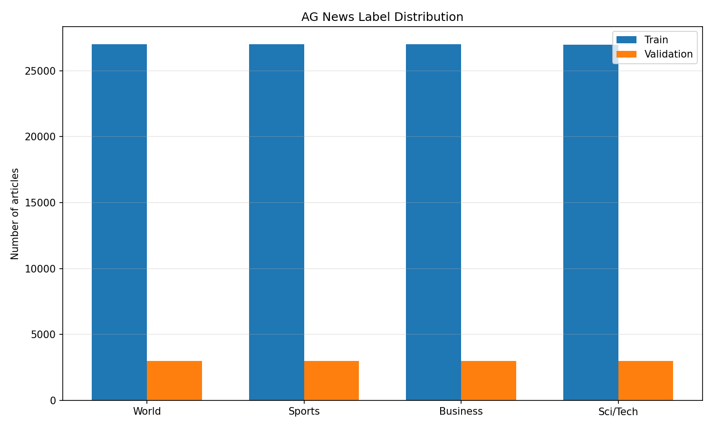
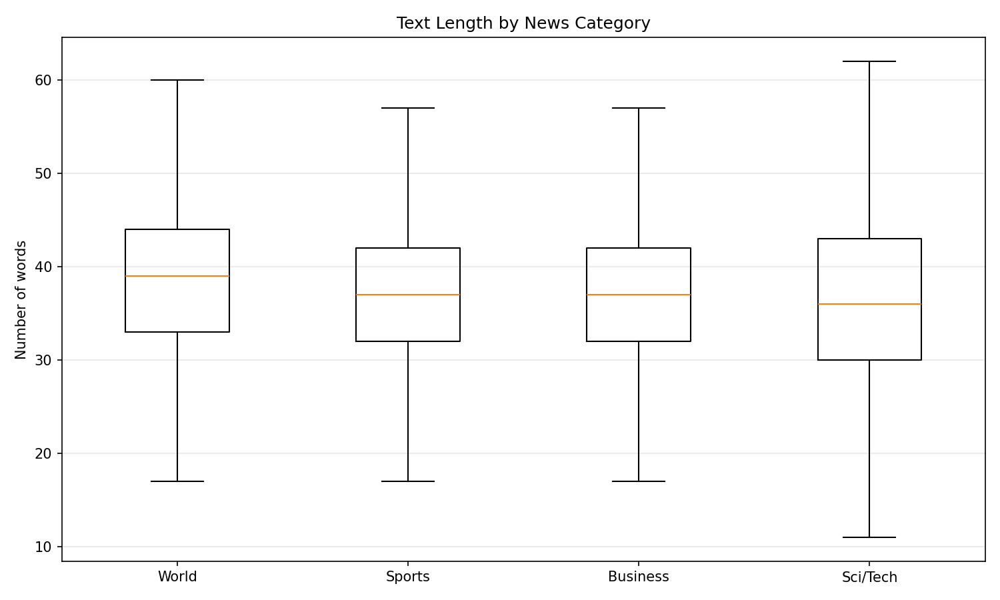
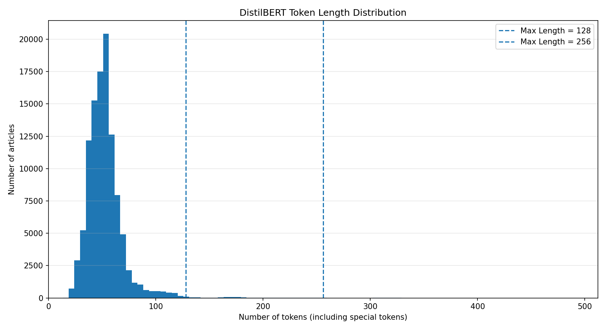
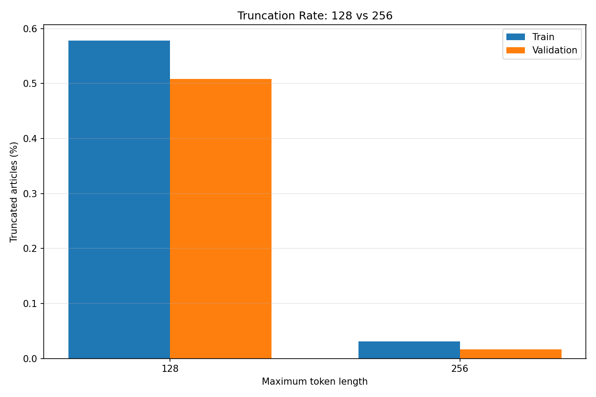
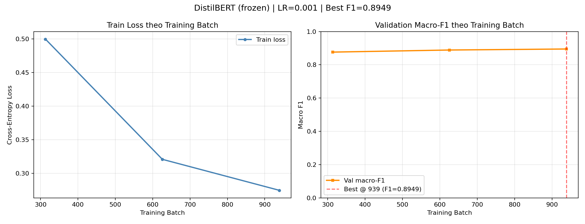
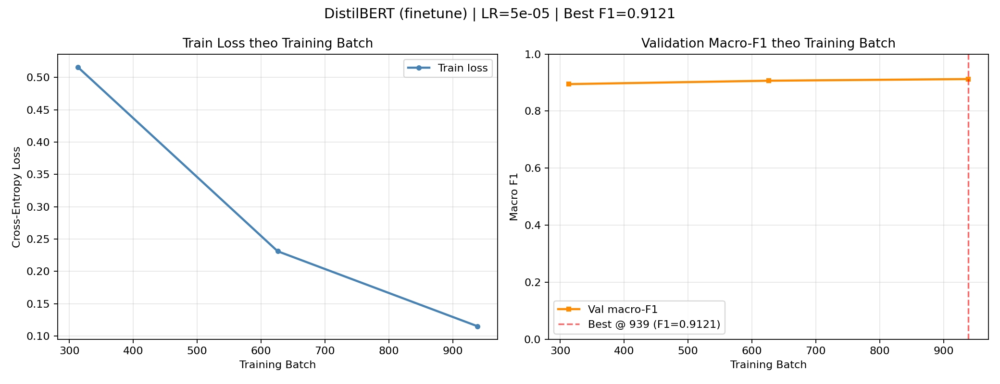
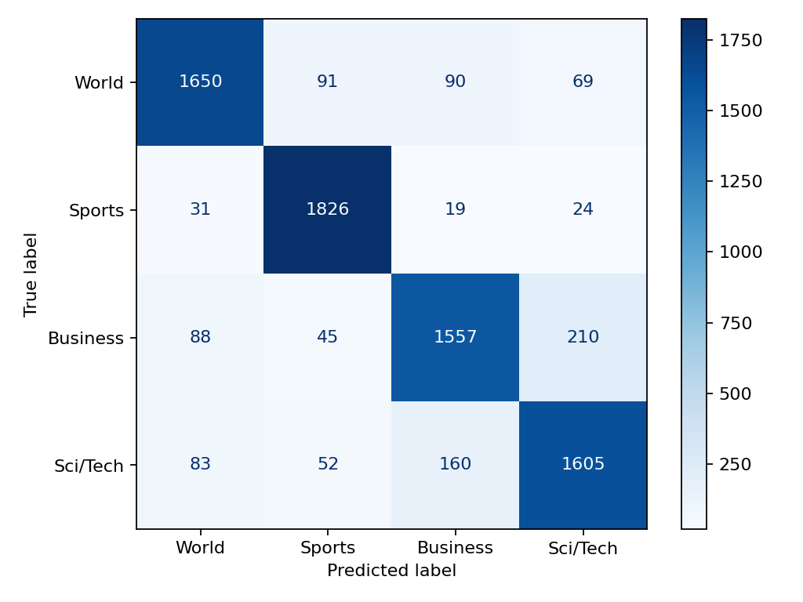
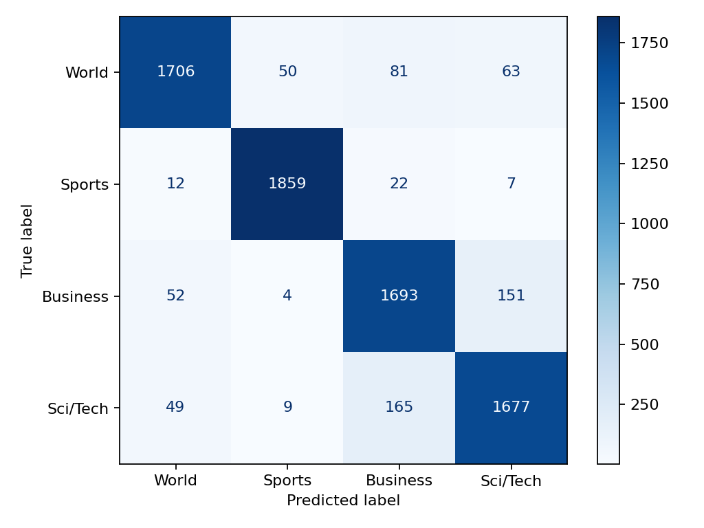

# Báo Cáo Tổng Hợp Dự Án: Phân Loại Chủ Đề Tin Tức AG News Với DistilBERT

**Tên dự án:** AG News – News Topic Classification (So sánh Baseline TF-IDF, Frozen DistilBERT Encoder và Full Fine-tuning DistilBERT)  
**Ngày hoàn thiện báo cáo:** `06/11/2026`  
**Tài liệu đối ứng tiếng Anh:** [`docs/report_eng.md`](report_eng.md)

---

## Danh sách Thành viên & Phân công Phụ trách

| Mã TV | Họ và tên | Vai trò chính | Mã Task phụ trách | Các phần báo cáo đóng góp |
|---|---|---|---|---|
| **TV1** | **Nguyễn Hoàng Minh Nhựt** | Dữ liệu, Tiền xử lý và Phân tích khám phá (EDA) | `AG-01 → AG-04` | Mục 1, Mục 2 ([`docs/data_audit.md`](data_audit.md), [`docs/eda.md`](eda.md)) |
| **TV2** | **Bùi Đặng Bảo Phúc** | Baseline (TF-IDF + Logistic Regression) & Frozen Encoder | `AG-05 → AG-08` | Mục 3 ([`docs/TRAINING.md`](TRAINING.md), [`docs/BASELINE_NOTES.md`](BASELINE_NOTES.md)) |
| **TV3** | **Trần Đức Lĩnh** | Fine-tuning DistilBERT, Tối ưu tài nguyên & Phân tích hội tụ | `AG-09 → AG-12` | Mục 4 ([`docs/FINETUNING.md`](FINETUNING.md), [`outputs/finetune/training_analysis.md`](../outputs/finetune/training_analysis.md)) |
| **TV4** | **Nguyễn Đình Trí** | Chuẩn hóa Đánh giá, So sánh Test, Phân tích lỗi & Kiểm thử | `AG-13 → AG-16` | Mục 5 ([`docs/EVALUATION.md`](EVALUATION.md), [`docs/RESULTS.md`](RESULTS.md), [`docs/ERROR_ANALYSIS.md`](ERROR_ANALYSIS.md)) |
| **TV5** | **Đỗ Hoàng Đăng** | Tích hợp hệ thống, Demo dự đoán, Tổng hợp Báo cáo & Thuyết trình | `AG-17 → AG-20` | Mục 6 & Biên tập tổng hợp ([`integration.md`](../integration.md), [`demo.md`](../demo.md)) |

---

## 1. Bài toán, Mục tiêu và Dữ liệu Gốc (Phụ trách: Nguyễn Hoàng Minh Nhựt – TV1)

### 1.1. Xác định bài toán và Câu hỏi nghiên cứu
Việc đọc và phân loại thủ công hàng trăm nghìn bản tin tiếng Anh vào các chuyên mục tiêu tốn nhiều thời gian và dễ thiếu nhất quán khi một bài báo giao thoa nhiều lĩnh vực. Dự án xây dựng một pipeline học máy đầu-cuối (end-to-end) để tự động phân loại mỗi bản tin tiếng Anh (gồm tiêu đề `Title` và mô tả tóm tắt `Description`) vào đúng một trong bốn chủ đề chuẩn của bộ dữ liệu **AG News**:

| Nhãn gốc (`Class Index`) | Nhãn nội bộ (`label`) | Tên lớp (`LABELS`) | Nội dung chuyên mục |
|---:|---:|---|---|
| `1` | `0` | **World** | Tin tức thời sự, chính trị, ngoại giao và sự kiện quốc tế |
| `2` | `1` | **Sports** | Tin tức thể thao, giải đấu, vận động viên và kết quả thi đấu |
| `3` | `2` | **Business** | Tin tức kinh doanh, tài chính, thị trường chứng khoán và doanh nghiệp |
| `4` | `3` | **Sci/Tech** | Tin tức khoa học, công nghệ, phần cứng, phần mềm và môi trường |

**Câu hỏi nghiên cứu trọng tâm của nhóm:**
- *Việc fine-tuning toàn bộ mô hình `distilbert/distilbert-base-uncased` có cải thiện chỉ số Macro-F1 so với phương pháp đóng băng bộ mã hóa (Frozen Encoder – chỉ huấn luyện tầng phân loại) đủ lớn để bù đắp chi phí thời gian huấn luyện và bộ nhớ GPU tăng thêm hay không? Khi đối chiếu với mô hình học máy truyền thống (TF-IDF + Logistic Regression), lợi ích thực tế của từng phương pháp là gì?*

### 1.2. Kiểm tra chất lượng dữ liệu gốc (`AG-01` – Data Audit)
Công cụ kiểm toán dữ liệu [`scripts/audit_data.py`](../scripts/audit_data.py) đã phân tích nguyên trạng hai tập dữ liệu gốc `data/raw/train.csv` và `data/raw/test.csv` mà không làm thay đổi dữ liệu nguồn (chi tiết tại [`docs/data_audit.md`](data_audit.md)):

| Tiêu chí kiểm tra | Tập `train.csv` gốc | Tập `test.csv` gốc | Nhận xét & Ý nghĩa kỹ thuật |
|---|---:|---:|---|
| **Tổng số dòng (`Rows`)** | `120.000` | `7.600` | Quy mô chuẩn của benchmark AG News |
| **Số cột (`Columns`)** | `3` (`Class Index`, `Title`, `Description`) | `3` (`Class Index`, `Title`, `Description`) | Đầy đủ các cột bắt buộc |
| **Giá trị bị thiếu (`Missing / Null`)** | `0` | `0` | Không có ô trống ở cả 3 cột |
| **Bài báo rỗng sau chuẩn hóa** | `0` | `0` | Mọi bản tin đều có nội dung hợp lệ |
| **Nhãn ngoài phạm vi `1..4`** | `0` | `0` | Toàn bộ nhãn gốc hợp lệ |
| **Phân bố mỗi lớp (`World / Sports / Business / Sci/Tech`)** | `30.000` mẫu/lớp (`25,00%`) | `1.900` mẫu/lớp (`25,00%`) | Dữ liệu cân bằng tuyệt đối giữa 4 lớp |
| **Dòng trùng khớp hoàn toàn (`Exact duplicate rows`)** | `0` | `0` | Không có dòng CSV trùng cả 3 cột nguyên bản |
| **Nhóm văn bản trùng sau khi ghép `Title + Description`** | `79` nhóm (`79` dòng dư) | `0` | Có 64 nhóm trùng văn bản cùng nhãn và **15 nhóm mâu thuẫn nhãn** |
| **Số văn bản duy nhất (`Unique texts`)** | `119.921` | `7.600` | Cần khử trùng lặp trước khi chia tập |
| **Văn bản giao nhau giữa `train` và `test`** | \multicolumn{2}{c|}{`4` bài báo (cùng nhãn)} | Tiềm ẩn **rò rỉ dữ liệu (data leakage)** nếu giữ trong tập train |

**Phân tích 15 nhóm văn bản trùng nhưng mâu thuẫn nhãn trong tập `train.csv`:**
- `Business` vs `Sci/Tech`: **12 nhóm** (chiếm `80%` số ca mâu thuẫn, phản ánh ranh giới mờ giữa tin doanh nghiệp công nghệ và sản phẩm công nghệ).
- `World` vs `Business`: **2 nhóm**.
- `World` vs `Sci/Tech`: **1 nhóm**.

---

## 2. Tiền xử lý, Phân tích Khám phá (EDA) và Chia tập (Phụ trách: Nguyễn Hoàng Minh Nhựt – TV1)

### 2.1. Quy trình chuẩn hóa văn bản và chống rò rỉ dữ liệu (`AG-02`, `AG-03`)
Module [`src/data.py`](../src/data.py) (và giao diện tương thích ngược [`src/dataset.py`](../src/dataset.py)) thực thi hợp đồng dữ liệu dùng chung cho mọi mô hình:
1. **Ghép và làm sạch nhẹ (`clean_text`):** Ghép `Title` và `Description` bằng một dấu cách, giải mã các thực thể HTML (`html.unescape`, ví dụ `&amp;` → `&`), gộp các khoảng trắng liên tiếp (`\s+` → `' '`). **Không** loại bỏ stopword, **không** stemming/lemmatization và **giữ nguyên chữ hoa/thường** ở bước dùng chung để không làm mất ngữ cảnh của chuỗi token đầu vào cho DistilBERT.
2. **Ánh xạ nhãn (`Label Mapping`):** Chuyển đổi `Class Index` từ `1..4` về số nguyên `0..3` tương ứng với `['World', 'Sports', 'Business', 'Sci/Tech']`.
3. **Khử trùng lặp và loại bỏ giao thoa (`Deduplication & Anti-Leakage Policy`):**
   - Loại bỏ văn bản trùng nội bộ trong `test` và trong `train` theo quy tắc giữ lần xuất hiện đầu tiên (`drop_duplicates('text')`).
   - Loại bỏ toàn bộ văn bản của `train` có xuất hiện trong `test` (`train = train[~train.text.isin(test.text)]`), đảm bảo **0% rò rỉ dữ liệu** từ tập kiểm tra sang quá trình huấn luyện và chọn siêu tham số.
4. **Chia tập `train / validation` có phân tầng (`Stratified Split`):**
   - Từ `119.917` mẫu train sạch, tách `90%` làm tập `train` và `10%` làm tập `validation` với `random_state = 42` và `stratify = train.label`.

| Tập dữ liệu (`data/processed/`) | Tổng số mẫu | `World (0)` | `Sports (1)` | `Business (2)` | `Sci/Tech (3)` | Mã băm `SHA-256` kiểm chứng |
|---|---:|---:|---:|---:|---:|---|
| **`train.csv`** (toàn bộ) | `107.925` | `26.986` | `26.986` | `26.984` | `26.969` | Tập nguồn huấn luyện |
| **`train` tập con** (`limit=5000`, seed 42) | `5.000` | `1.250` | `1.250` | `1.250` | `1.250` | `daf3a462722352b1e32251404c56939e...` |
| **`validation.csv`** | `11.992` | `2.999` | `2.998` | `2.998` | `2.997` | `b61a10f2594038187f5cc787551e41e3...` |
| **`test.csv`** | `7.600` | `1.900` | `1.900` | `1.900` | `1.900` | `e1242b5b4fb4039896e1524b10792deb...` |

### 2.2. Phân tích khám phá dữ liệu và Lựa chọn `max_length` (`AG-04`)
Script [`scripts/eda.py`](../scripts/eda.py) phân tích trên hai tập `train` (`107.925` mẫu) và `validation` (`11.992` mẫu), hoàn toàn không chạm tới `test` (báo cáo chi tiết tại [`docs/eda.md`](eda.md)):

- **Thống kê độ dài văn bản trên tập Train:**
  - Độ dài theo từ (`Word Count`): Trung bình `37,84` từ, trung vị `37` từ, `P90 = 48` từ, `P95 = 53` từ, `P99 = 70` từ, cực đại `177` từ.
  - Độ dài theo ký tự (`Character Count`): Trung bình `235,24` ký tự, trung vị `231` ký tự, `P95 = 338` ký tự, cực đại `976` ký tự.
  - Độ dài trung bình giữa 4 lớp rất đồng đều: `World` (`38,92` từ), `Sports` (`37,76` từ), `Business` (`37,52` từ), `Sci/Tech` (`37,19` từ; có bài đơn lẻ dài nhất `177` từ).

- **Phân tích độ dài Token (`distilbert/distilbert-base-uncased`) và Tỷ lệ cắt cụt (`Truncation`):**
  - Số token trung bình trên tập `train` (đã tính `[CLS]` và `[SEP]`): **`52,74` token**; phân vị thứ 99 (`P99`) là **`117` token**.

| Tập dữ liệu | Giới hạn `max_length` | Số bài bị cắt (`Truncated Articles`) | Tỷ lệ bài bị cắt (`%`) | Tổng số token bị cắt bỏ | Tỷ lệ token bị mất (`%`) |
|---|---:|---:|---:|---:|---:|
| **`train`** | `128` | `624` | **`0,58%`** | `30.071` | `0,55%` |
| **`train`** | `256` | `33` | `0,03%` | `1.514` | `0,03%` |
| **`validation`** | `128` | `61` | **`0,51%`** | `2.632` | `0,43%` |
| **`validation`** | `256` | `2` | `0,02%` | `48` | `0,01%` |

- **Quyết định thiết kế từ EDA:** Chọn **`max_length = 128`** làm cấu hình chuẩn cho toàn bộ thực nghiệm DistilBERT vì ngưỡng này giữ nguyên vẹn hơn **`99,42%`** số bài báo trong tập huấn luyện (chỉ mất `0,55%` tổng lượng token) nhưng giảm một nửa chiều dài chuỗi tối đa so với `256`, giúp tiết kiệm đáng kể bộ nhớ VRAM và thời gian tính toán của cơ chế Self-Attention.

---

## 3. Phương pháp Baseline TF-IDF và Frozen DistilBERT Encoder (Phụ trách: Bùi Đặng Bảo Phúc – TV2)

### 3.1. Giao thức thực nghiệm có kiểm soát
Để đảm bảo tính công bằng khi so sánh giữa các mô hình trong điều kiện phần cứng cục bộ (Laptop GPU), nhóm thống nhất giao thức thực nghiệm tại [`src/experiments.py`](../src/experiments.py) và [`docs/TRAINING.md`](TRAINING.md):
- **Tập huấn luyện chung:** Cùng tập con **`5.000` mẫu train** được lấy mẫu phân tầng cố định (`read_split('train', 5000)`, `seed = 42`, `train_sha256 = daf3a462...`).
- **Tập chọn mô hình:** Cùng tập **`11.992` mẫu validation** (`validation_sha256 = b61a10f2...`). Tiêu chí duy nhất để chọn siêu tham số và checkpoint là **Validation Macro-F1**.
- **Niêm phong tập Test:** Tập `test` (`7.600` mẫu) chỉ được đánh giá đúng một lần sau khi đã khóa cấu hình tại [`outputs/final_evaluation_protocol.json`](../outputs/final_evaluation_protocol.json) (`test_used_for_selection = false`).

### 3.2. Mô hình Baseline: TF-IDF + Logistic Regression (`AG-05`)
Cài đặt tại [`src/baseline.py`](../src/baseline.py) sử dụng pipeline hai bước của `scikit-learn`:
1. **Trích xuất đặc trưng (`TfidfVectorizer`):** `ngram_range = (1, 2)` (kết hợp unigram và bigram để bắt các cụm từ như `"stock market"`, `"world cup"`), `max_features = 50.000`, `sublinear_tf = True` ($1 + \log(\text{tf})$ để giảm tác động của các từ lặp lại quá nhiều). Bộ từ vựng chỉ được `fit` trên tập `train`, tuyệt đối không `fit` trên `validation` hay `test`.
2. **Bộ phân loại (`LogisticRegression`):** `max_iter = 1000`, `random_state = 42`.
   - Tổng số tham số huấn luyện của tầng phân loại tuyến tính: $50.000 \times 4 + 4 = \mathbf{200.004}$ tham số.
   - Thời gian chạy trên CPU (fit + đánh giá validation + lưu `model.pkl`): **`4,08` giây**.
   - Kết quả Validation trên đợt 5.000 mẫu train: Validation Accuracy = **`0,879086`**, Validation Macro-F1 = **`0,878600`**.
   - *(Ghi chú đối chiếu từ [`docs/BASELINE_NOTES.md`](BASELINE_NOTES.md): Khi thử nghiệm độc lập trên toàn bộ tập train lớn với `max_features=10.000`, TF-IDF + Logistic Regression có thể đạt Validation Macro-F1 khoảng `0,9145`. Tuy nhiên, trong báo cáo so sánh chính thức dưới đây, mọi mô hình đều được đối chiếu trên cùng tập train `5.000` mẫu để kiểm soát biến số dữ liệu).*

### 3.3. Mô hình Frozen DistilBERT Encoder (`AG-06`, `AG-07`, `AG-08`)
Trong chế độ `--mode frozen` tại [`src/transformer.py`](../src/transformer.py):
- **Cơ chế đóng băng:** Toàn bộ 6 khối Transformer của `distilbert/distilbert-base-uncased` được gán `p.requires_grad = False` và luôn đặt ở chế độ `model.base_model.eval()` trong suốt vòng lặp huấn luyện để tắt dropout của encoder.
- **Tầng phân loại được huấn luyện (`FrozenHead`):** Chỉ cập nhật 2 tầng tuyến tính của đầu phân loại (`pre_classifier: Linear(768 → 768) → ReLU → Dropout → classifier: Linear(768 → 4)`), tương ứng **`593.668` tham số huấn luyện** (chỉ chiếm **`0,89%`** trên tổng số `66.956.548` tham số của mô hình).
- **Tối ưu trích xuất đặc trưng CLS:** Do encoder cố định và ở chế độ `eval()`, vector biểu diễn `[CLS]` (`768` chiều) của tập `train` và `validation` được trích xuất một lần trên GPU (mất `30,37` giây) và lưu vào bộ nhớ đệm cho các lượt thử nghiệm Learning Rate, trong khi checkpoint xuất ra đĩa vẫn là mô hình Hugging Face đầy đủ để phục vụ `evaluate` và `predict`.
- **Kiểm chứng tính toàn vẹn của Encoder (`outputs/encoder_checks.json`):** So sánh mã băm SHA-256 của toàn bộ `100` tensor thuộc encoder sau khi train với checkpoint gốc `distilbert-base-uncased` (revision `12040acc...`) xác nhận **`100/100` tensor không thay đổi (`changed_encoder_tensors = 0`)**.

**Kết quả chọn Learning Rate cho Frozen Encoder (`AG-07` – 3 epoch, batch size 16, warmup 10%):**

| Thử nghiệm | Learning Rate | Epoch đạt đỉnh | Train Loss (Epoch 1 → 3) | Validation Macro-F1 | Thời gian ghi nhận (s) | Quyết định |
|---|---:|---:|---|---:|---:|---|
| `frozen_lr0.001` | **`1e-3`** | Epoch 3 | `0,5000 → 0,3208 → 0,2747` | **`0,894880`** | `42,08s` (gồm `30,37s` mã hóa CLS) | ✅ **Chọn (`outputs/frozen/`)** |
| `frozen_lr0.0005` | `5e-4` | Epoch 3 | `0,5841 → 0,3552 → 0,3127` | `0,894293` | `11,81s` (dùng lại cache CLS) | Không chọn |

- **Phân tích hạn chế của Frozen Encoder (`AG-08`):** Mặc dù biểu diễn ngữ nghĩa tiền huấn luyện của DistilBERT giúp `frozen` vượt qua `baseline` TF-IDF (`+1,63` điểm % Validation Macro-F1 trên tập 5.000 mẫu), các tầng Self-Attention bị đóng băng không thể điều chỉnh trọng số chú ý theo đặc thù thuật ngữ báo chí của AG News, khiến tốc độ giảm hàm mất mát chậm lại ở mức `0,2747` sau 3 epoch.

---

## 4. Fine-tuning Toàn bộ DistilBERT và Tối ưu Tài nguyên (Phụ trách: Trần Đức Lĩnh – TV3)

### 4.1. Kiến trúc Fine-tuning và Kiểm soát Hiện tượng Quên Thảm khốc (`AG-09`)
Trong chế độ `--mode finetune` tại [`src/transformer.py`](../src/transformer.py) (chi tiết tại [`docs/FINETUNING.md`](FINETUNING.md)):
- **Cập nhật toàn bộ mô hình:** Mở khóa cả 6 khối Transformer Encoder lẫn Classification Head, tối ưu toàn bộ **`66.956.548` / `66.956.548` tham số (`100%`)**. File [`outputs/encoder_checks.json`](../outputs/encoder_checks.json) xác nhận **`100/100` tensor của encoder đã được cập nhật** sau quá trình huấn luyện.
- **Linear Warmup Scheduler & Gradient Clipping:** Khi mới bắt đầu huấn luyện, tầng `classifier` khởi tạo ngẫu nhiên tạo ra gradient lớn có thể làm hỏng trọng số ngôn ngữ đã học của encoder (hiện tượng *Catastrophic Forgetting*). Hệ thống áp dụng:
  - Bộ tối ưu `AdamW` kết hợp `get_linear_schedule_with_warmup` với **`warmup_ratio = 0.1`** (tăng tuyến tính learning rate từ `0` lên ngưỡng mục tiêu trong `10%` tổng số bước đầu tiên, sau đó giảm tuyến tính về `0`).
  - Cắt chuẩn gradient `torch.nn.utils.clip_grad_norm_(model.parameters(), 1.0)` trước mỗi bước cập nhật trọng số.

### 4.2. Thực nghiệm chọn Learning Rate cho Fine-tuning (`AG-10`)
Giữ cố định tập dữ liệu (`5.000` mẫu train, `11.992` mẫu validation), `seed = 42`, `max_length = 128`, `batch_size = 16`, `epochs = 3`:

| Thử nghiệm | Learning Rate | Epoch đạt đỉnh | Train Loss (Epoch 1 → 3) | Validation Macro-F1 | Thời gian ghi nhận (s) | Quyết định |
|---|---:|---:|---|---:|---:|---|
| `finetune_lr2e-05` | `2e-5` | Epoch 3 | `0,5964 → 0,2647 → 0,1649` | `0,911828` | `980,96s` | Không chọn |
| `finetune_lr5e-05` | **`5e-5`** | Epoch 3 | `0,5163 → 0,2311 → 0,1149` | **`0,912148`** | `151,44s` | ✅ **Chọn (`outputs/finetune/`)** |

*(Lưu ý kỹ thuật: Mức chênh lệch Validation Macro-F1 giữa `5e-5` và `2e-5` là nhỏ (`0,912148` so với `0,911828`), và sự khác biệt thời gian đồng hồ giữa hai lượt chạy chịu ảnh hưởng của tải hệ thống trong phiên chạy nên không quy kết tốc độ thực thi cho giá trị learning rate).*

### 4.3. Tối ưu hóa bộ nhớ GPU và Chi phí tính toán (`AG-11`)
Thực nghiệm được chạy trên máy tính trang bị **NVIDIA GeForce RTX 4060 Laptop GPU** (`PyTorch 2.11.0+cu128`, `Transformers 4.57.1`), kích hoạt **Automatic Mixed Precision (`AMP - FP16`)** thông qua `torch.amp.autocast` và `GradScaler`:

| Mô hình được chọn | Thiết bị chạy | Tham số huấn luyện (`Trainable Params`) | Tỷ lệ tham số tối ưu | Bộ nhớ Tensor CUDA cực đại (`Peak CUDA Memory`) | Thời gian huấn luyện ghi nhận |
|---|---|---:|---:|---:|---:|
| **Baseline (`tfidf_logistic`)** | CPU (`4 threads`) | `200.004` | N/A (Tuyến tính) | Không dùng GPU | **`4,08` giây** |
| **Frozen (`LR = 1e-3`)** | CUDA (`RTX 4060 Laptop`) | `593.668` | `0,89%` | **`338,66 MiB`** (`355.110.400` bytes) | **`42,08` giây** |
| **Fine-tuning (`LR = 5e-5`)** | CUDA (`RTX 4060 Laptop`) | `66.956.548` | `100,00%` | **`1.325,19 MiB`** (`1.389.563.904` bytes) | **`151,44` giây** |

### 4.4. Phân tích đường học và Tiến trình hội tụ (`AG-12`)

| Epoch (Bước huấn luyện) | Frozen (`LR = 1e-3`) Train Loss | Frozen (`LR = 1e-3`) Val Macro-F1 | Fine-tuning (`LR = 5e-5`) Train Loss | Fine-tuning (`LR = 5e-5`) Val Macro-F1 |
|---|---:|---:|---:|---:|
| **Epoch 1** (`Step 313`) | `0,499957` | `0,876215` | `0,516297` | `0,894477` |
| **Epoch 2** (`Step 626`) | `0,320827` | `0,888793` | `0,231068` | `0,906353` |
| **Epoch 3** (`Step 939`) | `0,274659` | **`0,894880`** | `0,114928` | **`0,912148`** |

- **Nhận xét hội tụ:** Ngay từ cuối Epoch 1, Validation Macro-F1 của `finetune` (`0,8945`) đã ngang ngửa mức đỉnh sau 3 epoch của `frozen` (`0,8949`). Qua 3 epoch, `finetune` giảm hàm mất mát xuống `0,1149` (giảm `0,4014` so với Epoch 1) và đạt đỉnh Validation Macro-F1 tại `0,912148` mà chưa xuất hiện dấu hiệu giảm F1 trên tập validation.

---

## 5. Kết quả Đánh giá Tập Test, Confusion Matrix và Phân tích Lỗi (Phụ trách: Nguyễn Đình Trí – TV4)

### 5.1. Bảng so sánh chính thức trên tập Test (`AG-13`, `AG-14`)
Sau khi chốt cấu hình trên tập `validation`, cả 3 mô hình được đánh giá một lần duy nhất trên cùng tập **`test.csv` (`7.600` mẫu, `1.900` mẫu/lớp, `test_sha256 = e1242b5b...`)** thông qua lệnh `python -m src.main evaluate --run <run- --split test --config-finalized` và tổng hợp bằng `python -m src.main compare` (nguồn dữ liệu: [`outputs/validation_comparison.csv`](../outputs/validation_comparison.csv) và [`outputs/comparison.csv`](../outputs/comparison.csv)):

| Mô hình / Phương pháp | `train_n` | Validation Accuracy | Validation Macro-F1 | **Test Accuracy** | **Test Macro-F1** | Chênh lệch Test Macro-F1 so với Baseline |
|---|---:|---:|---:|---:|---:|---:|
| **1. Baseline (TF-IDF + Logistic Regression)** | `5.000` | `0,879086` | `0,878600` | `0,873421` (`87,34%`) | `0,872826` (`87,28%`) | Cơ sở đối chiếu (`0,00%`) |
| **2. DistilBERT Frozen Encoder (`LR = 1e-3`)** | `5.000` | `0,894763` | `0,894880` | `0,892500` (`89,25%`) | `0,892657` (`89,27%`) | **`+1,98` điểm %** |
| **3. DistilBERT Fine-tuning (`LR = 5e-5`)** | `5.000` | **`0,912108`** | **`0,912148`** | **`0,912500` (`91,25%`)** | **`0,912578` (`91,26%`)** | **`+3,98` điểm %** (`+1,99` điểm % so với Frozen) |

### 5.2. Kết quả chi tiết từng lớp (`Per-class Precision / Recall / F1`) trên tập Test (`7.600` mẫu)

| Chủ đề (`Class`) | Support | Baseline Precision | Baseline Recall | **Baseline F1** | Frozen Precision | Frozen Recall | **Frozen F1** | Fine-tuning Precision | Fine-tuning Recall | **Fine-tuning F1** |
|---|---:|---:|---:|---:|---:|---:|---:|---:|---:|---:|
| **0: World** | `1.900` | `0,8909` | `0,8684` | `0,8795` | `0,9222` | `0,8674` | `0,8940` | `0,9379` | `0,8979` | **`0,9175`** |
| **1: Sports** | `1.900` | `0,9067` | `0,9611` | `0,9331` | `0,9637` | `0,9789` | `0,9713` | `0,9672` | `0,9784` | **`0,9728`** |
| **2: Business** | `1.900` | `0,8527` | `0,8195` | `0,8357` | `0,8205` | `0,8663` | `0,8428` | `0,8633` | `0,8911` | **`0,8770`** |
| **3: Sci/Tech** | `1.900` | `0,8412` | `0,8447` | `0,8430` | `0,8679` | `0,8574` | `0,8626` | `0,8836` | `0,8826` | **`0,8831`** |
| **Trung bình vĩ mô (`Macro Avg`)** | `7.600` | `0,8729` | `0,8734` | **`0,8728`** | `0,8936` | `0,8925` | **`0,8927`** | **`0,9130`** | **`0,9125`** | **`0,9126`** |

- **Nhận xét theo lớp:**
  - **`Sports`** đạt F1 cao nhất ở cả 3 phương pháp (`0,9331 → 0,9713 → 0,9728`) do có hệ từ vựng đặc thù rất rõ ràng (tên giải đấu, tỷ số, môn thi đấu). Riêng việc chuyển từ TF-IDF sang biểu diễn ngữ nghĩa của DistilBERT (`frozen`) đã đưa F1 của `Sports` tăng vọt `+3,82` điểm %.
  - **`Business`** và **`Sci/Tech`** là hai lớp khó phân biệt nhất. Ở hai lớp này, `frozen` chỉ cải thiện nhẹ so với `baseline` (`+0,71%` ở `Business`), nhưng **`finetune` tạo ra bước nhảy vọt lớn (`+3,42` điểm % ở `Business` và `+2,05` điểm % ở `Sci/Tech` so với `frozen`)**, chứng tỏ việc cập nhật các tầng Self-Attention giúp mô hình phân tách ngữ cảnh kinh tế và công nghệ hiệu quả hơn nhiều so với đặc trưng đóng băng.

### 5.3. Ma trận nhầm lẫn (`Confusion Matrix`) trên tập Test

### 5.4. Phân tích lỗi định tính trên mô hình tốt nhất (`AG-15`)
Trên `7.600` mẫu test, mô hình `finetune` có **`665` dự đoán sai (`8,75%`)**. Phân bố 12 cặp nhầm lẫn trên toàn bộ tập test (chi tiết tại [`outputs/finetune/error_summary.json`](../outputs/finetune/error_summary.json) và [`outputs/finetune/error_analysis.md`](../outputs/finetune/error_analysis.md)):

| Hạng | Nhãn thật (`True Label`) | Nhãn dự đoán (`Predicted Label`) | Số mẫu sai | Tỷ trọng trong 665 lỗi |
|---:|---|---|---:|---:|
| 1 | `Sci/Tech` (`3`) | `Business` (`2`) | `165` | `24,81%` |
| 2 | `Business` (`2`) | `Sci/Tech` (`3`) | `151` | `22,71%` |
| 3 | `World` (`0`) | `Business` (`2`) | `81` | `12,18%` |
| 4 | `World` (`0`) | `Sci/Tech` (`3`) | `63` | `9,47%` |
| 5 | `Business` (`2`) | `World` (`0`) | `52` | `7,82%` |
| 6 | `World` (`0`) | `Sports` (`1`) | `50` | `7,52%` |
| 7 | `Sci/Tech` (`3`) | `World` (`0`) | `49` | `7,37%` |
| 8–12 | Các cặp còn lại (`Sports ↔ Business/World/SciTech`) | - | `54` | `8,12%` |
| **Tổng** | | | **`665`** | **`100,00%`** |

- **Nhận xét trọng tâm:** Chỉ riêng sự nhầm lẫn qua lại giữa hai lớp **`Business ↔ Sci/Tech` đã chiếm tới `316 / 665` lỗi (`47,52%` tổng số lỗi của toàn bộ tập test)**, hoàn toàn nhất quán với phát hiện ở bước Data Audit (`AG-01`) rằng `12/15` nhóm nhãn mâu thuẫn trong dữ liệu gốc cũng nằm ở cặp `Business vs Sci/Tech`.

**Tổng hợp 20 mẫu lỗi thực tế được chọn luân phiên qua 12 cặp nhầm lẫn (`seed = 42`):**

| Mã nhóm nguyên nhân (`error_category`) | Số mẫu (trên 20 mẫu) | Mẫu đại diện (`sample_id` trong `test_predictions.csv`) | Phân tích định tính |
|---|---:|---|---|
| **`topic_overlap`** (Chồng lấn chủ đề) | **`10`** | `#5431` (`Business → Sci/Tech`), `#7278` (`Sports → Business`), `#5020` (`Business → Sci/Tech`), `#2306` (`World → Business`) | Bài báo đồng thời chứa tín hiệu của cả hai chủ đề (ví dụ: hãng viễn thông Vodafone ra mắt dịch vụ mạng 3G; công đoàn cầu thủ giải NHL đàm phán cắt giảm 24% lương và trần lương; tập đoàn Internet AOL sa thải 700 nhân viên). |
| **`label_issue`** (Nghi vấn nhãn nguồn) | **`4`** | `#3186` (`World → Sports`), `#2591` (`World → Sports`), `#5067` (`Business → World`), `#7418` (`Sci/Tech → Business`) | Nội dung bản tin khớp hợp lý với nhãn do mô hình dự đoán hơn nhãn gốc (ví dụ `#3186`: *"Tennis: Night final for Aus Open The centenary Australian Open will be the first Grand Slam event..."* có nhãn gốc là `World` nhưng mô hình dự đoán `Sports`). Cần giữ nguyên nhãn chuẩn khi tính điểm nhưng ghi nhận giới hạn nhiễu nhãn của bộ dữ liệu. |
| **`insufficient_context`** (Thiếu ngữ cảnh) | **`4`** | `#344` (`Sports → World`), `#1840` (`Sports → Sci/Tech`), `#7030` (`Business → World`), `#1932` (`Sports → Business`) | Đoạn trích quá ngắn hoặc dùng lối viết ẩn dụ/văn phong đời thường không chứa từ khóa chuyên ngành (ví dụ `#344` chỉ mô tả việc đóng cửa chớp khi đi nghỉ ở châu Âu mà không nhắc tới môn thể thao nào). |
| **`entity_ambiguity`** (Thực thể đa nghĩa) | **`2`** | `#4058` (`Sci/Tech → Business`), `#5338` (`Sci/Tech → Sports`) | Tên tổ chức hoặc thuật ngữ dễ gây liên tưởng chéo (ví dụ `#5338` nói về trò chơi điện tử *"Halo 2"* với các từ *"game fans"* dễ trùng với người hâm mộ thể thao). |
| **`truncation`** (Bị cắt cụt do giới hạn token) | **`0`** | Không có (`token_count` của cả 20 mẫu nằm trong `27..123` token `<= 128`) | Cả 20 mẫu lỗi được chọn đều không vượt quá `max_length = 128`, khẳng định `truncation` không phải nguyên nhân gây lỗi trong mẫu phân tích này. |

---

## 6. Tích hợp, Demo, Kết luận, Hạn chế, Hướng phát triển và Đóng góp (Phụ trách: Đỗ Hoàng Đăng – TV5)

### 6.1. Tích hợp hệ thống và Kiểm thử (`AG-16`, `AG-17`)
- Toàn bộ pipeline đã được tích hợp dưới CLI thống nhất [`src/main.py`](../src/main.py) (chi tiết tại [`integration.md`](../integration.md)), hỗ trợ đầy đủ 7 lệnh (`prepare`, `baseline`, `train`, `evaluate`, `predict`, `compare`, `analyze-errors`), tự động chuẩn hóa bảng mã UTF-8 trên Windows console, thông báo lỗi thân thiện khi thiếu dữ liệu/mô hình và kiểm tra tính toàn vẹn SHA-256 tương thích đa nền tảng (`LF`/`CRLF`).
- Bộ kiểm thử tự động gồm **49 bài unit test** trong thư mục [`tests/`](../tests/) đạt **47/49 bài `OK` (`0 failures, 0 errors`)**, 2 bài trong `DeliveredModelTests` tự động `skip` khi chưa chép file trọng số `.safetensors` lớn (bị `.gitignore`) vào máy cục bộ; trên máy huấn luyện có đủ 3 trọng số, toàn bộ các bài kiểm thử mô hình thật đều đạt `100%`.

### 6.2. Kết quả Demo dự đoán (`AG-18`)
Script [`scripts/demo.py`](../scripts/demo.py) và tài liệu [`demo.md`](../demo.md) đã kiểm chứng luồng dự đoán trên **2 bộ dữ liệu Demo** (kết quả xuất tại [`outputs/demo_predictions.csv`](../outputs/demo_predictions.csv)):
1. **Bộ 8 bài báo tiếng Anh độc lập (2 bài/chủ đề):** Dự đoán chính xác **8/8 bài (`100%`)** qua luồng `predict` cho cả 4 chủ đề `World`, `Sports`, `Business`, `Sci/Tech`.
2. **Bộ 8 bài báo thực tế từ tập Test (2 bài/chủ đề) đối chiếu 3 mô hình:** Minh họa rõ các bản tin giao thoa ngữ cảnh mà `baseline` và `frozen` dự đoán sai nhưng mô hình tốt nhất **`finetune` dự đoán đúng hoàn toàn** (như bản tin đóng cửa sân bay Los Angeles do `"security breach"` `#1149`, sự cố an ninh tại Thế vận hội Athens `#126`, cuộc đình công tài xế xe tải tại New Delhi `#687`, và quy định giảm ô nhiễm khí thải tại California `#4`).

### 6.3. Kết luận trả lời Câu hỏi Nghiên cứu
1. **Fine-tuning toàn bộ DistilBERT so với Frozen Encoder:**
   - Trên cùng ngân sách `5.000` mẫu huấn luyện và `3` epoch, **Fine-tuning toàn bộ DistilBERT (`LR = 5e-5`)** đạt Test Macro-F1 = **`0,9126`** (`91,26%`), vượt **Frozen Encoder (`LR = 1e-3`, Test Macro-F1 = `0,8927`)** tới **`+1,99` điểm phần trăm** (giảm số lượng lỗi trên tập test từ `817` lỗi xuống còn `665` lỗi, tức **giảm `18,6%` lỗi tương đối**).
   - Mức cải thiện lớn nhất tập trung ở hai lớp khó nhất và dễ nhầm lẫn nhất là **`Business` (`+3,42` điểm % F1)** và **`Sci/Tech` (`+2,05` điểm % F1)**.
   - Về chi phí tài nguyên: Dù Fine-tuning cập nhật gấp `112,8` lần số tham số (`66,96M` vs `593K`), bộ nhớ CUDA cực đại khi bật AMP FP16 chỉ là **`1.325 MiB` (~`1,3 GB` VRAM)** và thời gian huấn luyện 3 epoch trên `5.000` mẫu chỉ mất **`151,44` giây (~`2,5` phút)** trên GPU phổ thông (RTX 4060 Laptop). Hơn nữa, ở pha suy luận (`inference`), cả Frozen và Fine-tuning đều phải chạy qua toàn bộ 6 tầng DistilBERT nên chi phí suy luận là tương đương. **Do đó, khi có GPU, việc Fine-tuning toàn bộ DistilBERT hoàn toàn xứng đáng để đổi lấy mức tăng gần 2 điểm % Macro-F1.**
2. **Đối chiếu với Baseline TF-IDF + Logistic Regression:**
   - **Fine-tuning DistilBERT** vượt **Baseline TF-IDF (`0,8728`)** tới **`+3,98` điểm phần trăm** trên cùng tập train `5.000` mẫu nhờ khả năng nắm bắt ngữ nghĩa ngữ cảnh sâu và xử lý từ đa nghĩa.
   - Tuy nhiên, **TF-IDF + Logistic Regression** chỉ mất **`4,08` giây trên CPU** (nhanh hơn `37` lần so với Fine-tuning trên GPU) mà vẫn đạt `87,28%` Test Macro-F1 với 5.000 mẫu (và khoảng `91,45%` Validation Macro-F1 khi huấn luyện trên toàn bộ dữ liệu). Vì vậy, TF-IDF là lựa chọn tối ưu cho môi trường chỉ có CPU hoặc cần huấn luyện/triển khai tức thời với chi phí cực thấp.

### 6.4. Hạn chế của Thực nghiệm và Hướng phát triển
- **Hạn chế hiện tại:**
  1. **Quy mô tập huấn luyện và số lần chạy (`Seed`):** Phép so sánh có kiểm soát giữa 3 mô hình hiện thực hiện trên tập con `5.000` mẫu train (`~4,6%` tập train sạch `107.925` mẫu) với một `seed = 42` cố định. Chưa chạy nhiều seed để tính độ lệch chuẩn (`mean ± std`) hoặc huấn luyện full `107.925` mẫu cho cả hai chế độ Transformer.
  2. **Giới hạn phân tích lỗi:** Các nhóm nguyên nhân lỗi ở `AG-15` là giả thuyết định tính dựa trên việc đọc văn bản, chưa kết hợp công cụ giải thích nội tại của mô hình (như Attention rollout, Integrated Gradients hay SHAP).
  3. **Phạm vi bài toán:** Mô hình hiện tại chỉ gán nhãn cứng vào 1 trong 4 lớp tiếng Anh, chưa xuất xác suất hiệu chuẩn (`calibrated confidence`) để phát hiện bài báo ngoài miền (`out-of-distribution`) hoặc gán đa nhãn (`multi-label`) cho các bài báo thực sự thuộc cả `Business` và `Sci/Tech`.
- **Hướng phát triển tiếp theo:**
  1. Mở rộng thực nghiệm lên toàn bộ `107.925` mẫu train với `3–5` random seed và thử nghiệm các kỹ thuật **Parameter-Efficient Fine-Tuning (PEFT / LoRA)** để đạt chất lượng tiệm cận Full Fine-tuning nhưng chỉ cần huấn luyện `< 1%` số tham số như Frozen.
  2. Bổ sung cơ chế **Label Smoothing** hoặc phân loại đa nhãn (`Multi-label Classification` / `Top-2 Accuracy`) cho cặp lớp giao thoa mạnh `Business ↔ Sci/Tech`.
  3. Xây dựng REST API / giao diện Web hiển thị kèm xác suất dự đoán (`Softmax probability`) và các từ khóa có trọng số chú ý cao nhất.

### 6.5. Bảng ghi nhận Đóng góp Thực tế (`AG-19`)

| Thành viên | Mã Task | Sản phẩm mã nguồn, dữ liệu & tài liệu bàn giao thực tế | Trạng thái |
|---|---|---|---|
| **Nguyễn Hoàng Minh Nhựt (TV1)** | `AG-01 → AG-04` | [`src/data.py`](../src/data.py), [`src/dataset.py`](../src/dataset.py), [`scripts/audit_data.py`](../scripts/audit_data.py), [`scripts/eda.py`](../scripts/eda.py), [`docs/data_audit.md`](data_audit.md), [`docs/eda.md`](eda.md), 5 biểu đồ trong [`docs/figures/`](figures/), [`tests/test_data.py`](../tests/test_data.py) | Hoàn thành (`Review`) |
| **Bùi Đặng Bảo Phúc (TV2)** | `AG-05 → AG-08` | [`src/baseline.py`](../src/baseline.py), nhánh `--mode frozen` trong [`src/transformer.py`](../src/transformer.py), thực nghiệm `frozen_lr0.001` & `frozen_lr0.0005` trong [`outputs/experiments/`](../outputs/experiments/), [`outputs/baseline/`](../outputs/baseline/), [`outputs/frozen/`](../outputs/frozen/), [`docs/BASELINE_NOTES.md`](BASELINE_NOTES.md), [`docs/TRAINING.md`](TRAINING.md) | Hoàn thành (`Review`) |
| **Trần Đức Lĩnh (TV3)** | `AG-09 → AG-12` | Nhánh `--mode finetune`, AMP FP16, Warmup Scheduler & `plot_training_history` trong [`src/transformer.py`](../src/transformer.py), thực nghiệm `finetune_lr2e-05` & `finetune_lr5e-05`, [`outputs/finetune/`](../outputs/finetune/), [`docs/FINETUNING.md`](FINETUNING.md), [`tests/test_training.py`](../tests/test_training.py) | Hoàn thành (`Review`) |
| **Nguyễn Đình Trí (TV4)** | `AG-13 → AG-16` | [`src/metrics.py`](../src/metrics.py), [`src/evaluation.py`](../src/evaluation.py), [`src/error_analysis.py`](../src/error_analysis.py), [`outputs/comparison.csv`](../outputs/comparison.csv), [`outputs/finetune/error_review.csv`](../outputs/finetune/error_review.csv), [`docs/EVALUATION.md`](EVALUATION.md), [`docs/ERROR_ANALYSIS.md`](ERROR_ANALYSIS.md), [`docs/RESULTS.md`](RESULTS.md), bộ unit tests [`tests/`](../tests/) | Hoàn thành (`Done / Review`) |
| **Đỗ Hoàng Đăng (TV5)** | `AG-17 → AG-20` | [`main.py`](../main.py), [`src/main.py`](../src/main.py), [`src/__init__.py`](../src/__init__.py), [`scripts/demo.py`](../scripts/demo.py), [`outputs/demo_predictions.csv`](../outputs/demo_predictions.csv), [`integration.md`](../integration.md), [`demo.md`](../demo.md), [`docs/report_vi.md`](report_vi.md), [`docs/report_eng.md`](report_eng.md), [`log.md`](../log.md) | Hoàn thành (`Review`) |

---

## 7. Nguồn Dữ liệu và Tài liệu Tham khảo

1. **Bộ dữ liệu AG News:** Gulli, A. (2004), *AG's corpus of news articles*; phiên bản benchmark phân loại 4 lớp do Xiang Zhang, Junbo Zhao, Yann LeCun giới thiệu trong *"Character-level Convolutional Networks for Text Classification"*, NeurIPS 2015 (`120.000` mẫu huấn luyện, `7.600` mẫu kiểm tra).
2. **Mô hình DistilBERT:** Victor Sanh, Lysandre Debut, Julien Chaumond, Thomas Wolf (2019), *"DistilBERT, a distilled version of BERT: smaller, faster, cheaper and lighter"*, Hugging Face Checkpoint: [`distilbert/distilbert-base-uncased`](https://huggingface.co/distilbert/distilbert-base-uncased) (revision `12040accade4e8a0f71eabdb258fecc2e7e948be`).
3. **Thư viện & Công cụ:** PyTorch (`2.11.0+cu128`), Hugging Face Transformers (`4.57.1`), scikit-learn (`1.7.2`), pandas, NumPy, Matplotlib.
