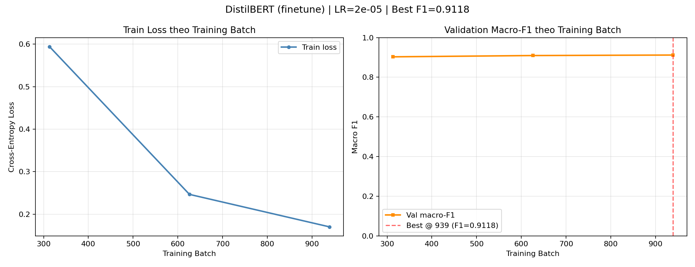

# AG-12 – Phân tích hội tụ: finetune (LR=2e-05)

## Thông tin thực nghiệm
- Mode: `finetune`
- Learning rate: `2e-05`
- Số epoch: `3`
- Batch size: `16`
- Max length: `128`
- Warmup ratio: `0.1`
- Eval steps: `0`
- Mixed Precision (AMP): `True`
- Số mẫu train: `5000`
- Thiết bị: `cuda`
- Số tham số huấn luyện: `66,956,548`
- Thời gian huấn luyện: `981.0s`

## Lịch sử đánh giá

| Step | Epoch | Train Loss | Validation Macro-F1 |
|-----:|------:|----------:|--------------------:|
| 313 | 1.0 | 0.5944 | 0.9029 |
| 626 | 2.0 | 0.2464 | 0.9093 |
| 939 | 3.0 | 0.1700 | 0.9118 |

## Nhận xét hội tụ

- Loss tại mốc đầu `0.5944`, mốc cuối `0.1700` (thay đổi `-0.4244` qua 3 mốc đánh giá).
- Validation macro-F1 đạt cao nhất `0.9118` tại Training Batch `939` (Epoch 3.0).
- So với mốc đầu, loss cuối thấp hơn và validation F1 cuối không giảm. Các mốc này chưa đủ để kết luận đã hội tụ.

## So sánh với frozen encoder (TV2)

Fine-tuning cập nhật encoder; frozen chỉ cập nhật classification head. Chỉ so sánh chất lượng sau khi có metrics của cả hai trên cùng validation và cùng tập train. Đồ thị của một lượt chạy chưa chứng minh phương pháp nào tốt hơn.

## Đồ thị

